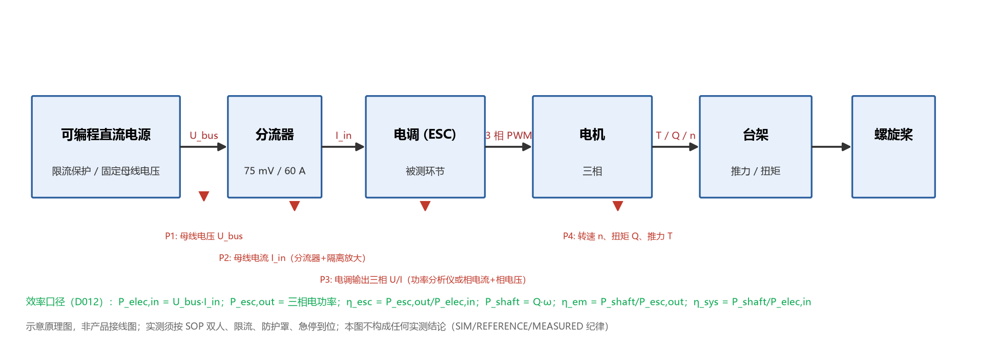

# 电调效率测量接线与测点表 v0.1

- 目的：把"电调作为被测环节"的测点、仪表、记录字段与安全要求固定下来，供台架搭建（M0.4）与实测（MEASURED）使用
- 状态：方案草案（2026-11-21），尚未在真机验证；示意原理图见下
- 关联：D012（效率口径）、D032（标定）、D035（MEASURED 门禁）、`docs/test/试验执行SOP_v0.1.md`

## 1. 测点定义

| 测点 | 位置 | 量 | 仪表/方法 | 记录字段 |
|---|---|---|---|---|
| P1 | 电源—电调母线上 | U_bus | 可编程电源读数 / 分压隔离采样 | `voltage_v` |
| P2 | 母线上 | I_in | 75 mV/60 A 分流器 + 隔离放大 + ADC | `current_a` |
| P3 | 电调三相输出 | 三相 U/I（或相电流+母线电压推算） | 功率分析仪（首选）/ 三电阻采样 | `p_esc_in_w`、`p_esc_out_w` |
| P4 | 电机轴—台架 | 转速 n、扭矩 Q、推力 T | 光电转速、反扭矩臂、S 型拉压力 | `rpm`、`torque_Nm`、`thrust_N` |

## 2. 效率口径（与 D012 一致）

- 电调输入功率：P_elec,in = U_bus · I_in
- 电调输出功率：P_esc,out = 三相电功率之和（或功率分析仪读数）
- 电调效率：η_esc = P_esc,out / P_elec,in
- 电机电磁效率：η_em = P_shaft / P_esc,out，P_shaft = Q·ω，ω = 2π·n/60
- 系统效率：η_sys = P_shaft / P_elec,in = η_esc · η_em

> 若台架暂无法测三相功率，最小可行方案：只测 P_elec,in 与轴功率，系统效率仍成立；此时 η_esc 记"未测"，不得用厂商曲线替代（D012）。

## 3. 接线与安装要求

1. 分流器串在电源正极（或负极）母线，信号经隔离放大后进 ADC，避免共模干扰；
2. 电压采样在电调输入端就近取，线径与接线端子满足 60 A 峰值；
3. 三相输出线等长、双绞以减少环路面积；示波器探头使用时注意共地；
4. 电源设限流（首次 1 A），母线并 TVS 与足够容量电解电容；
5. 急停串在电源输出侧（或电调供电），防护罩就位后才允许带桨。

## 4. 数据记录与校验

- 每个工况稳定 ≥3 s 后记录；重复 ≥3 次（与 `design_matrix` 排程一致）；
- meta 中写明：电流测点（母线侧）、电压测点、分流器阻值/增益、采样率；
- 实测前必须通过 `measured_readiness.py`（simulated:false、mode=serial、通道齐全）；
- 复测判据：与地图预测偏差 ≤1.5% 或 ≤2σ（D045/D012）。

## 5. 待办

- 按此图更新 `docs/design/数据采集方案_DAQ_v0.1.md` 通道表（增加 P3 电调输出功率）；
- 台架搭建完成后，用砝码标定 + 万用表/功率分析仪互校；
- 开题 PPT「台架与测量」页使用本图。
