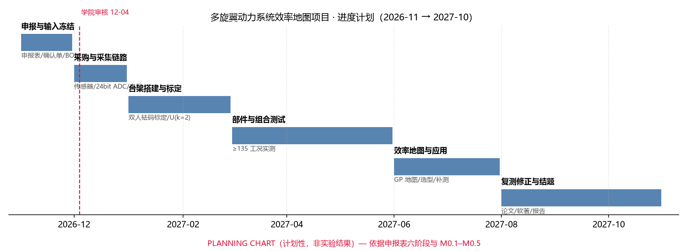

# 项目待办与决策清单 v0.1

> 用途：把散落在 README / decisions / 各文档里的“待办、阻塞、需人工确认”汇总到一处，供组会与导师沟通时逐条勾销。
> 更新：2026-11-21（Round 35）· 维护：A（组长）· 口径：只列需要行动的事项，已完成项见根 README 状态表。

## 1. 需人工/外部输入（阻塞项）

| # | 事项 | 阻塞内容 | 责任 | 下一步 |
|---|---|---|---|---|
| B1 | 项目成员姓名、学号、负责人 | 申报表第 2 步与结题材料署名 | 用户/组长 | 提供后由 A 录入并暂存 |
| B2 | 指导教师确认（宋受俊） | 教师审核与电子签名流程 | A | 按学校指南走“立项管理—指导教师签名” |
| B3 | 台架与传感器到货 | M0.4 实测链路与后续全部实测 | B | 按 BOM 询价 3 家、12 月下单 |
| B4 | 学院审核节点（12-04 前） | 申报提交截止 | A | 12-01 前完成附件上传与提交 |
| B5 | 本机 Word 可用性 | v3 申报表修订痕迹/PDF、Word COM 自动化 | 用户 | 关闭占用实例后可补生成 |

## 2. 项目内部待办（可自动推进）

| # | 事项 | 说明 | 状态 |
|---|---|---|---|
| P1 | 论文 §4.1 占位表填实测值 | M0.4 后按 SOP 采集并替换 | 等 B3 |
| P2 | 申报附件 01/04 再刷新 | 每次里程碑后按最新测试数/页数重生成 | 自动 |
| P3 | 答辩/结题 PPT 骨架 | 12 表 Excel + 图件 → 15–20 页 | 待做 |
| P4 | 论文 §2 相关工作配图 | 方法演进图（部件表征 → 地图 → 闭环） | 待做 |
| P5 | 根目录重复 docx 清理 | 被 Word 占用的 `附件3…_已填写.docx` | 等 B5 |
| P6 | git push 到远端 | origin 停在 92c177b，本地已有 r10/r21/r27/r30 里程碑 tag | 需用户确认远端 |

## 3. 数据与脚本约束（不要再犯）

- `python` 是 3.15，项目脚本一律用 `py -3.12`；
- PowerShell 执行策略禁止 `.ps1`，用 `pwsh -Command` 或 `Invoke-Expression`；
- 含中文的 `.ps1` 必须 UTF-8 BOM 或改用 Python；
- 数据真值是 CSV/JSON；Excel/Word 只是展示副本（D046）；
- SIM / REFERENCE / MEASURED 三类必须全程标注，实测前不得把 SIM 写成结论（D012/D029/D031/D042）；
- 目录/文件写入前先 `Set-Location` 到 `D:\下载\创新`，避免相对路径落错位置。

## 4. 下一次组会建议议程（30 分钟）

1. B1/B2 状态（5 min）；
2. BOM 询价进展与 12 月采购计划（10 min）；
3. M0.4 台架搭建分工与安全交底（10 min）；
4. 论文/申报材料进度对齐（5 min）。

## 5. 进度计划（甘特图）

> 计划性时间轴，非实验结果；关键节点：学院审核 12-04。

## 2026-11-22 v5 治理更新（R101–R114）

### 已完成
- [x] 一致性审计脚本 + 接入 round_close（HARD=0）
- [x] 附件 01–04 按 v4 口径刷新（REFERENCE 方法验证限定）
- [x] 开题答辩 PPT v0.2（同桨型·电压对比页）
- [x] 论文对标/占位表措辞统一，新增 §4.2 实测填数规则
- [x] Excel/Word 导出与结题材料包清单刷新（2026-11-22）
- [x] 中英双名索引（对外提交件保留正式名）
- [x] v4 四线交叉核对表 + v5 治理总结/移交说明
- [x] 本地发布包 release_r111.zip + SHA256
- [x] 里程碑 tag milestone-2026-11-22-r110

### 待用户侧
- [ ] 申报表第 2–5 步：成员姓名学号（系统录入）
- [ ] 申报表 v3/v4 修订痕迹与最终 PDF（需本机 Word 可用）
- [ ] 根目录重复 `附件3…_已填写.docx` 清理（关闭 Word 后 git rm）
- [ ] 远端 push（origin 仍在初始提交 92c177b；建议私有仓库）
- [ ] BOM 询价/下单、最小采集链路与双人砝码标定（M0.4）

### 2026-11-22 增补

- [x] 根目录 14 页 `_已填写.docx` 已归档至 `docs/申报/申报表/`（原被 Word 占用，现已解除）；
- [x] M0.4 启动包已建（`docs/inputs/M0.4启动包_M0.4KickoffPack_v0.1.md` + 读数 CSV 模板，干跑验证通过）；
- [ ] 远端 push：已尝试 `git push origin main --tags` → 网络无法连接 github.com:443（失败），待网络可用时重试；
- [ ] 硬件采购与双人砝码标定（M0.4）——按启动包执行。
