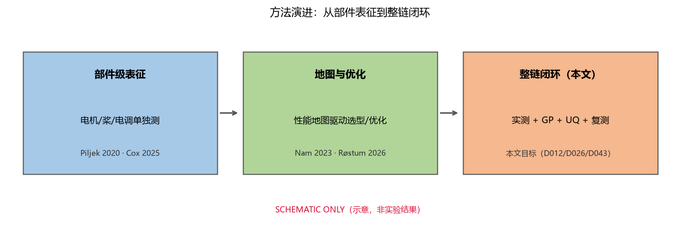
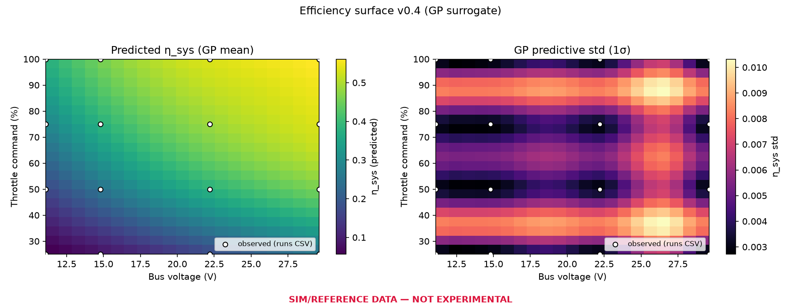
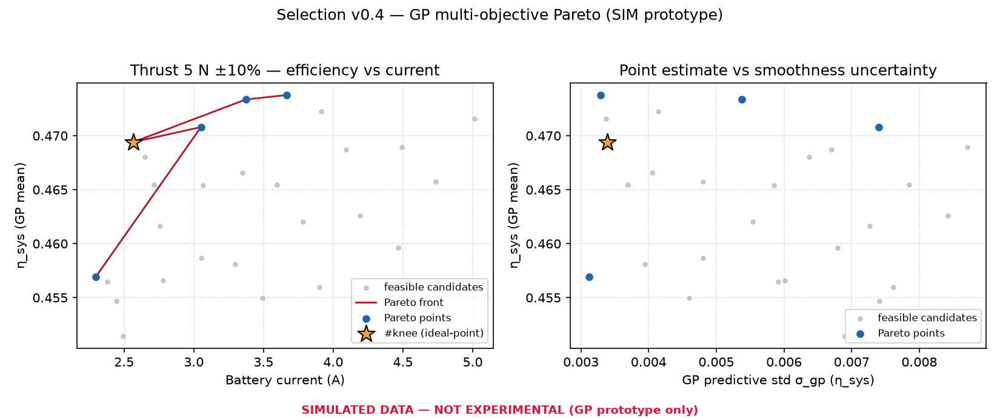
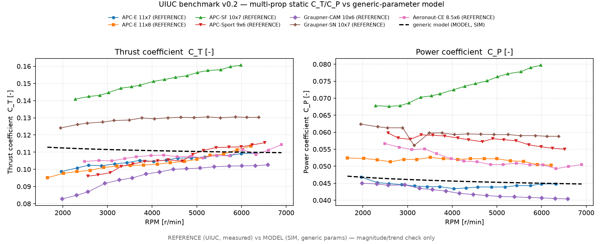

# 多旋翼无人机电机—螺旋桨—电调系统效率地图构建方法（草稿）

> 版本：v0.1 方法草稿 · 2026-11-21 · 面向大创结题/论文初稿的骨架，非最终稿
> 数据边界：文中所有数值结果均来自 **SIM（物理仿真合成数据）** 或 **REFERENCE（UIUC 公开风洞数据）**，**不是本项目实测结果**，不构成台架性能结论。实测数据将在 M0.4（最小采集链路 + 双人砝码标定）完成后按 MEASURED 通路入库并重跑。

**摘要**：多旋翼动力系统的效率由电机、电调与螺旋桨共同决定，单件效率相乘无法准确描述整链效率，且公开的宽工况系统级效率数据稀缺。本文提出一套"部件测试—系统组合—数据建模—效率地图—应用与复测"的地面试验方法：以单轴立式台架同步测量推力、反扭矩、转速与电参量，用标准砝码静态标定建立可追溯的力/扭矩量值；在电压×油门×桨型的正交工况上采集整链效率，基于高斯过程（GP）建立平滑效率代理并给出预测标准差；进一步把效率地图用于"同推力下桨型与母线电压匹配"以及"主动补测点推荐"，并用公开螺旋桨风洞数据检验模型先验的量级与趋势。当前阶段以仿真与公开数据验证方法与工具链（277 项自动化测试），实测验证正在进行。

**关键词**：多旋翼；推进系统；系统效率；效率地图；高斯过程；试验设计；不确定度

## 1 引言

多旋翼无人机的续航与作业能力直接受动力系统效率制约。工程上常见的做法是分别取电机效率、电调效率与螺旋桨效率再相乘，但三者工作点相互耦合：电压与油门决定转速，转速决定气动效率与铜耗，电池内阻与温升又反过来改变母线电压与绕组电阻。整链效率因此是"工况的函数"，而不是三个常数的乘积。

以电力巡检场景为例：单架次能巡多少基塔、是否需要中途换电，本质上取决于悬停与巡航两个典型工作点上的整链效率与可用能量。若能在常用推力区间内测得系统效率并绘成"电压×油门×桨型"的地图，选型与作业规划就可以从经验判断转为数据查询。

本文的目标是建立一套**低年级本科生可完成、可复现、可交接**的地面试验方法，并给出配套的开源工具链。主要工作包括：（1）同步测量推力/反扭矩/转速/电压/电流的单轴台架与砝码标定流程；（2）统一整链效率口径与不确定度传播；（3）基于试验设计与 GP 代理的效率地图构建方法；（4）基于地图的桨型—电压匹配与主动补测策略；（5）用公开风洞数据校准模型先验并给出适用边界。

### 1.1 研究问题与贡献概述

面向巡检作业的选型问题可归纳为：**在给定推力需求与供电条件下，如何用可复现的实测数据回答"选哪支桨、用哪档电压最省电"**。现有工作或停在部件级表征、或在仿真中比较组合，缺少"整链实测 + 不确定度 + 回到台架复测"的闭环。本文的目标是建立一套轻量、可复现的方法学，而非宣称某个具体桨型更优。

据此，本文的贡献可概括为三点：

1. **口径统一**：以 η_em = P_shaft/P_elec、FM = T^1.5/√(2ρA)/P_shaft、η_sys = FM·η_em 统一定义部件与整链效率，并用 U(k=2) 给出地图不确定度带（D012/D026）；
2. **方法闭环**：台架实测 → GP 代理建模 → 效率地图 → 选型/补测建议 → 复测修正，每步有门禁与可执行检查（MEASURED 门禁、SOP、DoE 排程、σ/EI 补测策略）；
3. **可复现与可交接**：281 项自动化测试、软著级源代码页与复现包清单、全流程文档与数据边界标注（SIM/REFERENCE/MEASURED 分离）。

## 2 相关工作

**台架效率测试**。风洞与推力台架测量螺旋桨性能已有成熟做法，UIUC 螺旋桨数据库（Brandt 等）公开了数百个桨型的静态与风速扫描数据，是公开数据对标的常用基准[6][18]。国内民用多旋翼试验方法可参考 GB/T 38058—2019《民用多旋翼无人机系统试验方法》，电机与电调系统可参考 GB/T 39567—2020《多旋翼无人机用无刷伺服电动机系统通用规范》；螺旋桨—动力系统匹配试验另有团体标准 T/XJBX 001—2024。

**电机—螺旋桨匹配选型**。工程实践多采用部件模型加厂商数据表，按拉力/力效排序选择动力组合[13][15]（如 Piljek 等对多旋翼动力系统选型的系统梳理）；开源工具多停留在"部件级"估算，缺少整链实测闭环。

**效率地图与数据驱动建模**。响应面、GP 与神经网络等代理模型在气动与推进系统建模中应用广泛；GP 的优势是同时给出预测均值与方差[10][22]，便于主动采样与不确定度量化。但现有效率地图工作多针对单一部件或单一桨型，且较少回到台架做复测闭环。

**控制分配层节能**。多旋翼总推力可在多个电机间分配，不同分配对应不同转速与电功率；已有研究指出分配策略对能耗有影响[7]，但很少用整链实测效率地图量化这一空间。

### 2.1 与最接近工作的对照

| 工作 | 对象/范围 | 方法 | 数据 | 与本文差异 |
|---|---|---|---|---|
| Nam 等（2023）[18] | 电动推进系统性能地图 | 性能地图用于选型与优化 | 部件模型 + 试验数据 | 偏优化，未给出整链实测地图与不确定度 |
| Piljek 等（2020）[13] | 多旋翼电推进系统 | 表征方法与试验流程 | 台架测量 | 单组合表征，未覆盖"电压×油门×桨型"地图 |
| Røstum 等（2026）[22] | 螺旋桨气动预测 | 深度 GP 概率预测 | 风洞/公开数据 | 只到桨气动，未闭环到整链效率与选型 |
| Cox 等（2025）[21] | 多旋翼推进测试 | 测试仪器与流程 | 台架 | 侧重仪器与测量规范，无地图与匹配应用 |
| 本文（目标） | 电机—桨—电调整链 | 台架实测 + GP 代理 + U(k=2) + 主动补测 + 复测 | 实测（计划）+ SIM/REFERENCE（当前） | 整链实测地图 + 不确定度 + 补测闭环三合一 |

**小结**：现有工作分别成熟于"部件测试""选型匹配""代理建模"，缺口在于"整链实测 + 平滑代理 + 不确定度 + 复测"的一体化闭环，以及公开的宽工况系统级效率数据。本文方法针对这一缺口，且把范围收缩到巡检常用推力区间以保证可完成性。

## 3 系统与方法

### 3.1 台架与量测

采用单轴立式台架：螺旋桨向上产生推力，反扭矩由力臂与拉压力传感器测量。测量通道与量程按 0.5–2 kg 推力级、8–18 寸桨设计：推力 0–10 kg（0.05% FS）、反扭矩 0–20 N·m（力臂 0.25 m）、转速光电 10–50000 r/min、母线电压 0–60 V、电流经 75 mV/60 A 分流器、温度 K 型热电偶。力、扭矩与转速采样率不低于 1 kS/s，电压电流不低于 10 kS/s（当前采集链路以 1 kS/s 折衷，见 3.5 节限制）。台架要求桨盘离地不小于 1.5 倍桨径、下游 1 倍桨径无遮挡、电机座挠度小于 0.1 mm，并加装 5 mm PC 防护罩与串联在电调供电回路的急停。

标定采用 M1 等级标准砝码，按 0/20/40/60/80/100% FS 加载与卸载，每点重复 3 次，最小二乘拟合 `F = k·raw + b`，记录 R²、重复性与迟滞（目标 R² ≥ 0.9995、重复性/迟滞 ≤ 0.5% FS）。标定文件固定写入 `simulated: false`，由双人签字；数据入库前经 MEASURED 门禁检查标定、元数据与通道完整性。

### 3.2 效率定义与不确定度

设推力 `T`、反扭矩 `Q`、转速 `n`、母线电压 `U`、电流 `I`，空气密度 `ρ`、桨盘面积 `A`，定义：

- 轴功率 `P_shaft = Q·ω = 2πnQ/60`
- 电功率 `P_elec = U·I`
- 机电效率 `η_em = P_shaft / P_elec`
- 理想功率 `P_ideal = T^{3/2} / sqrt(2ρA)`
- 悬停效率（品质因数）`FM = P_ideal / P_shaft`
- 整链系统效率 `η_sys = P_ideal / P_elec = FM · η_em`

空气密度优先用实测温压计算（`ρ = p·1000/(287.05(T+273.15))`），缺省 1.204 kg/m³。不确定度按 GUM 传播[23]，力/扭矩标定引入的 B 类不确定度与重复性合成，给出 `U(k=2)`；目标为 `η_sys` 相对不确定度 ≤ 3%。预测标准差（GP σ）与测量不确定度（U）严格区分，二者不可相加或互相替代。

### 3.3 试验设计

工况矩阵取 3 个母线电压（如 11.1/14.8/22.2 V，按 3S–6S 电池组对应）× 5 个油门（20/40/60/80/100%）× 3 种桨型 × 3 次重复 = **135 次运行**，单次时长与稳态窗口可配置（当前基线 2.5 s 采集、1.5 s 稳态窗口）。采用可编程直流电源固定母线电压以消除电池压降影响；每次换桨后重新紧固与动平衡检查。针对"按目标推力选型"的需求，另提供给定目标推力反解油门的排程模式（用 GP 推力代理二分反查，超出代理可达范围的目标记入跳过清单，不外推），并支持按块随机化顺序以减少温漂与人为因素的系统偏差。

每个工况的验收判据：稳态窗口内推力/转速相对标准差 ≤ 1%、`η_em` 与 `FM` 位于 (0,1)、复测值与地图预测的偏差落在重复性离散度（或 ≤ 2σ）内。

### 3.4 效率地图建模

把每个工况的稳态统计量汇总为一张 runs 表（电压、油门、桨型、各指标均值/标准差），再按"电压×油门"分桨型构建地图。基线方法为 GP 回归：特征取归一化的 `(V/30, throttle/100)`，使用 RBF 核与固定小噪声项，核宽由留一交叉验证（LOOCV）RMSE 选择；预测输出均值面与标准差面。GP 只做数据平滑，不做物理外推：观测凸包之外的区域不用于选型结论。对每个桨型另可用"整链机理模型 + 响应面修正"作为对照，以留出交叉验证比较两种模型的精度与失效边界。

### 3.5 效率地图的应用

**匹配示例**：在悬停与巡航两个典型推力点上，按地图查询各候选（桨型, 电压）组合的 `η_sys`，在满足推力公差（如 ±10%）与最高转速/母线电流约束下排序；对同推力的多个可行解做多目标 Pareto 分析（效率、电流、预测稳健性），并给出 knee 点作为推荐。

**主动补测**：利用 GP σ 或期望改进（EI）选择下一批测量点，在"全局地图精度"与"最优值跟踪"两种目标间权衡；在仿真闭环中比较不同策略的收益，作为实机补测的排程依据。

**分配层节能（边界内）**：同一总推力下改变各电机转速分配会改变总电功率，可用地图做静态核算；该分析不涉及飞控实现，仅为后续控制策略研究提供起点。

### 3.6 不确定度传播实现（软件）

系统效率的测量不确定度按 GUM 口径分项后，用 Monte Carlo 在稳态窗口上传播：对推力/扭矩标定斜率（1σ 0.5%）、
标定偏置（0.2%）、母线电压（0.5%）、电流（0.5%）、转速（0.1%）与空气密度（1.0%）独立抽样，
逐样本重算 T、Q、η_em、FM、η_sys，取 N=1000 次的均值、标准差与 95% 区间，并输出单因素 1σ 灵敏度贡献
（实现见 `code/processing/uncertainty.py`，D050）。该模块与 D012 的效率口径、D026 的 GP 预测标准差严格区分：
前者是测量不确定度，后者是代理模型插值不确定性，二者不直接相加。

## 4 当前进展与初步结果

以下结果全部为方法验证性质：SIM 为物理仿真合成数据（参数为文献量级，未辨识），REFERENCE 为 UIUC 公开风洞数据。

**效率地图与选型**。在 4 电压×4 油门的 16 个仿真工况上，GP 代理的 LOOCV RMSE 为 0.0017（`η_sys` 量级 0.1–0.55），核宽 0.55；据此在 5 N ±10% 推力需求下得到 5 个 Pareto 点，knee 点为 29.6 V / 52.5%（`η_sys` 0.469，保守值 0.446）。

**补测策略**。在仿真闭环中比较不补测、σ 贪心、EI 与随机四种策略各 10 轮，σ 策略把网格 RMSE 从 0.00634 降至 0.00102（约 6.2 倍），holdout RMSE 从 0.0191 降至 0.0015（约 13 倍）；EI 次之。该结论仅为代理层面的方法学比较。

**公开数据方法验证（REFERENCE，非项目主线；v4 口径为同一桨型、不更换桨型）**。用 UIUC 8 个桨型、112 个静态点检验通用参数化模型：`C_T` 平均绝对误差 11.37%、`C_P` 16.68%（带符号 −0.69% / −13.62%），误差随桨型差异显著（最大 35.8% / 43.5%）。逐桨反推先验可把样本内误差降到 0.3–1.5%，但该先验被标记为 `do_not_apply`，只能作为模型标定方向的参考，不能替代实测。

**仿真补充**。双节点热网络给出短时过载温升与冷却曲线（绕组峰值 82.9 °C、定子 66.2 °C，冷却至 35 °C 约 132 s），电池内阻压降模型表明高油门段母线电压下降对效率有 0.1–0.3 个百分点量级影响；两者仅用于测试排程与风险提示。

### 4.1 实测替换清单与结果占位表

M0.4 完成后按本表逐项替换（当前列只填仿真/公开数据值，实测列留空由试验填写）：

| 指标 | 当前值（SIM/REFERENCE） | 实测目标 | 实测值（待填） | 判据 |
|---|---|---|---|---|
| 推力标定 R² / 重复性 / 迟滞 | 合成标定 0.9999（占位） | R²≥0.9995、≤0.5% FS | — | D032 |
| 稳态采样率 | 1000 S/s（SIM） | ≥990 S/s（10 min） | — | 门禁 |
| U(k=2) of η_sys | 2.1%（仿真预算） | ≤3% | — | D012/D032 |
| GP 地图 LOOCV RMSE | 0.0017（16 SIM 点） | TBD（≥135 点后重估） | — | D026 |
| 同推力匹配 knee | 29.6 V/52.5%，η 0.469（SIM） | 实测重跑 | — | D024 |
| 补测策略收益 | σ vs none ≈6.2×（SIM 闭环） | 实机复验 | — | D041 |
| UIUC 方法验证误差（REFERENCE） | CT 11.37% / CP 16.68%（通用先验） | 保持参考 | — | D031 |
| 双节点热峰值 | 绕组 82.9 °C / 定子 66.2 °C（SIM） | 实测曲线辨识参数 | — | D029 |

**替换纪律**：替换前确认数据通过 `measured_readiness` 门禁且地图重跑；论文、报告、Excel 同步更新，旧 SIM 值保留在 `data/processed/` 与历史版本中，不覆盖。

### 4.2 实测填数规则（占位表模板说明）

| 列 | 含义 | 数据来源 | 填数规则 |
|---|---|---|---|
| 指标 | 待替换的占位指标名 | 与 §4.1 表一致 | 必填 |
| 当前值(SIM/REFERENCE) | 现有模拟/参考值 | 对应 CSV/JSON 产物 | 保持原值并注明来源类型 |
| 实测目标 | 设计目标/验收判据 | 设计文档 D032/D035/D043 | 不得低于申报承诺 |
| 实测值(待填) | M0.4 之后填入 | `calibration_fit.py`、`measured_readiness.py`、`compute_efficiency.py` 输出 | 保留 3 位有效数字 + 单位 |
| 依据 | 决策/文档编号 | D0xx / 设计文档 | 必填 |

**填数三条规则**：
1. 任何实测值必须来自 MEASURED 通路（`--require-measured` 拒绝 SIM/REFERENCE 混入）；
2. 标定类指标（R²、重复性、迟滞）以 `calibration_fit.py` 的 `metrics` 字段为准，双人签字后生效；
3. 填表后同步更新 §4.1 表与附录图表，并在 `data/processed/` 保留对应产物；论文正文不得直接引用未入库数值。

### 4.3 建模对照与不确定度（深化结果，SIM/REFERENCE）

**几何特征代理（负结果，REFERENCE）**。为回答「仅凭几何量能否预测桨性能」，用 UIUC 8 桨 / 112 点做
5 特征线性代理（直径、螺距比、转速及平方项），以留一桨型（LOPO）验证：`C_T` 平均绝对误差由通用先验的
11.37% 变为 19.21%，`C_P` 由 16.68% 变为 19.61%，**未优于通用先验**（D049）。原因是 7 个桨型的直径与
螺距比高度共线，留一桨型时只能外推，而偏差由系列/翼型/雷诺效应主导；个别桨型有改善但不具泛化性。
该结果说明：同一桨型实测地图 + GP 平滑仍是本项目主线，几何代理只作方法学对照。

**不确定度传播（SIM 演示，D050）**。对 SIM 工况 `20261117_SIM_22V2_50pct_R1`，名义 η_sys = 0.2749，
Monte Carlo（N=1000）得均值 0.2749、标准差 0.0032、95% 区间 [0.2687, 0.2814]（宽度约 1.27 pp）；
单因素 1σ 贡献最大为推力标定斜率（0.00204 pp），其次为电流（0.00142 pp）、空气密度（0.00136 pp）与
电压（0.00131 pp）。实机标定完成后须替换误差假设并重跑，结果才可写入论文实测章节。

## 5 讨论与局限

（1）**尚无实测**。当前所有效率数值来自仿真或公开数据；标定、门禁与复测流程已就绪，但必须等 M0.4 硬件链路与双人砝码标定完成后才能给出实测结论。（2）**无来流**。地面台架为静态悬停条件，向巡航工况外推需风洞或飞行试验对照，本文只做定性修正。（3）**单旋翼台架**。整机多旋翼存在桨间干扰与机身遮挡，单轴结果不能直接等同于整机效率。（4）**电调效率**。电调损耗与调制方式、温度相关，本文通过电功率在输入端测量把电调计入整链，但未单独分离电调效率。（5）**样本量**。GP 在 135 点以内的精度依赖工况覆盖，外推区不可用；主动补测策略仍需实机检验。

### 5.1 预期结果与贡献

1. 一套可复现的单轴地面台架与双人静态标定流程（M0.4 起给出实测标定 JSON 与不确定度预算）；
2. 覆盖"供电电压×油门×桨型"的整链效率数据集（≥135 次有效采集，按 D043 排程与 SOP 执行）；
3. 带 U(k=2) 不确定度的 GP 效率地图及已知失效边界（外推区与样本稀疏区显式标注）；
4. 选型与主动补测工具链（插值/Pareto/σ/EI 策略）的闭环验证方法（先仿真、后实机复验）；
5. 可交接的成果材料：方法论文草稿、软件著作权材料、复现包与结题报告素材。

工程价值（定性）：为巡检类多旋翼在"同推力需求下选桨型与供电电压"提供实测依据；量化控制分配层的节能空间（同一总推力不同转速分配对应不同电功率，仅静态计算，不改硬件）。

### 5.2 风险与缓解

| 风险 | 可能影响 | 缓解措施 |
|---|---|---|
| 台架加工/传感器到货延迟 | M0.4 与后续节点顺延 | 提前锁定 3 家询价；等待期用软件在环与公开数据对标推进 |
| 标定不确定度超标 | 地图与结论误差放大 | 双人加载/卸载、M1 砝码、6 点拟合、逐项核 U 预算；不达标重标 |
| 电机温升与电池压降漂移 | 工况间数据不可比 | 每工况预热 30 s、稳态窗口 3 s、温升 >5 ℃ 暂停；可编程电源固定母线电压 |
| 台架气流/地面效应 | 向真实飞行外推有偏差 | 桨盘离地 ≥1.5D、下游 1D 无遮挡；必要时借校内风洞对照；论文限定外推范围 |
| 进度与课程冲突 | 节点延误 | 三角色分工 + 每周例会 + S0/S1 门禁；硬件等待期并行软件成果与材料 |

## 6 结论与下一步

本文给出了面向多旋翼动力系统的整链效率地图构建方法与工具链：统一效率口径与不确定度、135 次运行的试验设计、GP 平滑代理与不确定度面、基于地图的匹配与补测策略，以及公开数据对标流程。仿真与公开数据验证了方法的自洽性（277 项自动化测试全绿），下一步是完成最小采集链路与静态标定，把首份 MEASURED 数据按门禁入库并重跑地图，随后按 S2–S4 阶段推进多工况测试、地图 v1.0 与应用复测，并在实测数据上复验补测策略。

## 参考文献（23 条，DOI/来源已核验；投稿前按 GB/T 7714—2025 统一格式）

[1] GB/T 38058—2019. 民用多旋翼无人机系统试验方法[S]. 北京: 中国标准出版社, 2019.
[2] GB/T 39567—2020. 多旋翼无人机用无刷伺服电动机系统通用规范[S]. 北京: 中国标准出版社, 2020.
[3] GB/T 46460—2025. 无人驾驶航空器用锂离子电池和电池组规范[S]. 北京: 中国标准出版社, 2025.
[4] T/XJBX 001—2024. 无人机桨发匹配试验技术规范[S]. 2024.
[5] GB/T 7714—2025. 信息与文献 参考文献著录规则[S]. 北京: 中国标准出版社, 2025.
[6] Brandt J B, Deters R W, Ananda G K, Dantsker O D, Selig M S. UIUC Propeller Database, Vols 1–4[DB/OL]. University of Illinois at Urbana-Champaign, 2022.
[7] Theys B, Dimitriadis G, Hendrick P, De Schutter J. Influence of propeller configuration on propulsion system efficiency of multi-rotor UAVs[C]//2016 International Conference on Unmanned Aircraft Systems (ICUAS). IEEE, 2016. DOI: 10.1109/ICUAS.2016.7502520.
[8] Brandt J B, Selig M S. Propeller performance data at low Reynolds numbers[C]//49th AIAA Aerospace Sciences Meeting. AIAA 2011-1255, 2011. DOI: 10.2514/6.2011-1255.
[9] Deters R W, Ananda Krishnan G K, Selig M S. Reynolds number effects on the performance of small-scale propellers[C]//AIAA 2014-2151, 2014. DOI: 10.2514/6.2014-2151.
[10] Shahriari B, Swersky K, Wang Z, Adams R P, de Freitas N. Taking the human out of the loop: a review of Bayesian optimization[J]. Proceedings of the IEEE, 2016, 104(1): 148–175. DOI: 10.1109/JPROC.2015.2494218.
[11] Shi D, Dai X, Zhang X, Quan Q. A practical performance evaluation method for electric multicopters[J]. IEEE/ASME Transactions on Mechatronics, 2017. DOI: 10.1109/TMECH.2017.2675913.
[12] Shin Y T, Teh Y K. Design analysis and considerations of power efficient electronic speed controller for small-scale quadcopter unmanned aerial vehicle[C]//2018 IEEE CCWC, 2018. DOI: 10.1109/CCWC.2018.8301770.
[13] Piljek P, Kotarski D, Krznar M. Method for characterization of a multirotor UAV electric propulsion system[J]. Applied Sciences, 2020, 10(22): 8229. DOI: 10.3390/app10228229.
[14] Dantsker O D, Caccamo M, Deters R W, Selig M S. Performance testing of Aero-Naut CAM folding propellers[C]//AIAA AVIATION 2020 Forum, AIAA 2020-2762, 2020. DOI: 10.2514/6.2020-2762.
[15] Amici C, Ceresoli F, Pasetti M, Saponi M, Tiboni M, Zanoni S. Review of propulsion system design strategies for unmanned aerial vehicles[J]. Applied Sciences, 2021, 11(11): 5209. DOI: 10.3390/app11115209.
[16] Hernandez J D, Nandar J E, Changoluisa I D, Cruz P J, Valencia E. Test-bench development for the efficiency analysis of UAV motor-propeller sets[C]//2021 IEEE ETCM, 2021. DOI: 10.1109/ETCM53643.2021.9590717.
[17] Dantsker O D, Caccamo M, Deters R W, Selig M S. Performance testing of APC electric fixed-blade UAV propellers[C]//AIAA AVIATION 2022 Forum, AIAA 2022-4020, 2022. DOI: 10.2514/6.2022-4020.
[18] Nam H S, Hwang H S, Lee S H, Lee H T. Electric propulsion system optimization using performance maps[C]//2023 IEEE Aerospace Conference, 2023. DOI: 10.1109/AERO55745.2023.10115581.
[19] Goli S, Kurtuluş D F, Alhems L M, Memon A M, Imran I H. Experimental study on efficient propulsion system for multicopter UAV design applications[J]. Results in Engineering, 2023, 20: 101555. DOI: 10.1016/j.rineng.2023.101555.
[20] Xu J, Jin W, Lin H, Zhang B, Guo H. Multiobjective optimization method to maximize power density and efficiency of an electric propulsion motor in UAV applications[J]. IEEE Transactions on Transportation Electrification, 2024. DOI: 10.1109/TTE.2023.3319008.
[21] Cox B, Dantsker O D, Deters R W. Propulsion system testing instrumentation for multi-rotor and lighter-than-air UAVs[C]//AIAA SCITECH 2025 Forum, AIAA 2025-0252, 2025. DOI: 10.2514/6.2025-0252.
[22] Røstum H H, Afonso F, Morlier J. Deep Gaussian processes for probabilistic prediction of UAV propeller aerodynamics[C]//MATEC Web of Conferences, 2026, 422: 02007. DOI: 10.1051/matecconf/202642202007.
[23] JCGM. Evaluation of measurement data — Guide to the expression of uncertainty in measurement (GUM), JCGM 100:2008[R]. BIPM, 2008.
