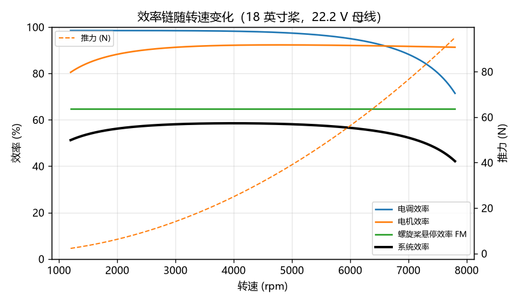
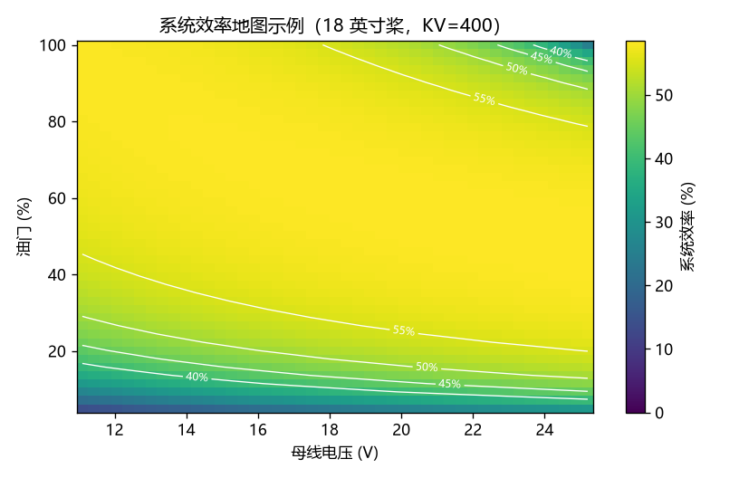
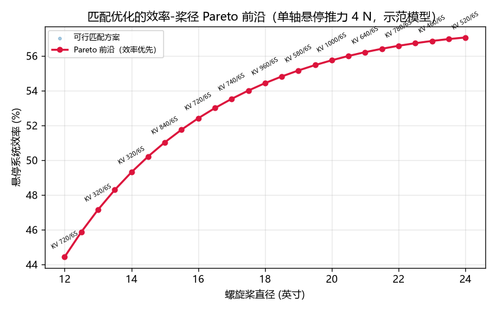
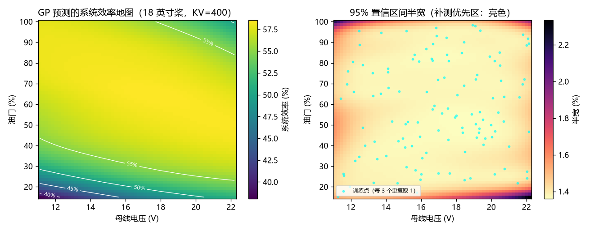
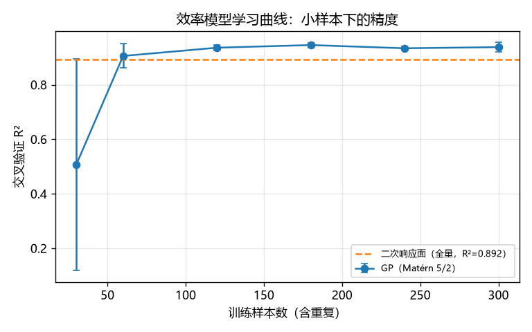

# 多旋翼无人机电机—螺旋桨—电调系统效率地图项目：推进规划与技术预研

**版本**：v1.1　　**编制日期**：2026-11-17　　**适用对象**：项目组 5 名 2026 级成员、指导教师及课题组研究生

**文档用途**：把申报书中的研究内容细化为可执行的工作分解（WBS），明确每个工作包要做什么、需要提前准备什么（知识/设备/资料/软件）、产出什么、如何验收，并给出进度、分工、数据管理、预研结果与近期启动清单，作为项目周会与中期检查的工作底稿。

---

## 目录（章节导航）

本规划共 11 章 + 4 个附录。建议按章节顺序阅读：第 1—2 章为项目定位与技术路线，第 3 章（WBS）是任务细化的核心，第 4—7 章为环境、进度、分工与数据规范，第 8 章为技术预研结论，第 9 章为风险，第 10 章为技能清单与学习路径，第 11 章为近两周启动清单，附录为传感器、记录表、参考资料与环境文件。

- 一、项目定位与目标
- 二、总体技术路线
- 三、工作分解结构（WBS）：每一部分需要什么、产出什么
- 四、软件与工具环境
- 五、实施进度计划
- 六、团队分工与协作机制
- 七、数据与代码管理规范
- 八、技术预研（阶段 0 结论）
- 九、风险识别与应对
- 十、技能清单与学习路径（2026 级新生版）
- 十一、近期启动清单（2026-11-17 至 2026-11-30）
- 附录 A 传感器与采集选型清单（精简版）
- 附录 B 测试记录表字段模板（可直接建表）
- 附录 C 参考资料与数据源
- 附录 D 环境与文件清单

## 一、项目定位与目标

### 1.1 选题背景（一句话版）

多旋翼无人机的续航受电池能量密度制约，而“电池→电调→电机→螺旋桨”整条能量链上每一环的效率损失都会直接转化为悬停功率增加与航时缩短；工程上电机、电调、螺旋桨通常由不同厂家分别标定，组合后的真实效率存在较大不确定性，缺少系统级、多工况的定量评价手段。

### 1.2 总目标

面向多旋翼动力系统，搭建地面效率测试台架，建立“电机—螺旋桨—电调”组合的系统效率评价方法与效率地图，并在此基础上开展参数匹配优化，形成可复用的测试规范、数据集与匹配选型方法，为整机动力系统选型、能耗分析与控制策略设计提供量化依据。

### 1.3 具体目标与验收指标

| 编号 | 指标 | 目标值 | 验证方式 | 完成时间 |
| --- | --- | --- | --- | --- |
| G1 | 效率测试台架 | 1 套，具备推力、扭矩、转速、电压、电流同步采集能力 | 台架验收测试：静态标定 + 重复性试验 | 2027-03 |
| G2 | 效率数据集 | ≥500 组有效工况（多电压、多油门、多电机-桨组合） | 数据完整性/重复性检查报告 | 2027-05 |
| G3 | 效率模型 | 部件效率模型 + 系统效率映射，交叉验证决定系数 R²≥0.90 | 留出法/交叉验证报告 | 2027-07 |
| G4 | 系统效率地图 | 覆盖常用工况（3S~6S、10%~100% 油门）的效率地图 | 地图与实测抽查点误差 ≤5% | 2027-07 |
| G5 | 匹配优化方案 | 2~3 套推荐匹配方案（电机 KV/桨径/电压组合）+ Pareto 方案集 | 台架复测对比报告 | 2027-09 |
| G6 | 成果产出 | 研究报告 1 份；力争论文 1 篇、软著/专利 1 项 | 结题材料 | 2027-10 |

### 1.4 范围界定（做什么 / 不做什么）

- **做**：静态与准静态工况下的效率测试、效率建模、效率地图、悬停/巡航典型工况的匹配寻优、台架验证。
- **不做**：飞控算法开发、电池老化建模、新电机/新桨叶的气动设计、真实飞行试验（可作为后续工作）。
- **边界条件**：标准大气环境（记录温度、湿度、气压）；地面无来流条件为主，来流影响只做理论修正与讨论；以 5~30 英寸桨、3S~12S 供电的多旋翼动力系统为对象。

### 1.5 成功标准（从评审视角）

1. 能回答“给定一套动力部件，在什么工况下效率最高、为什么”；
2. 能回答“给定任务需求（推力/航时），应如何选电机 KV、桨径与电压”；
3. 所有结论都有可复现的数据、代码与不确定度说明。

---

## 二、总体技术路线

技术路线按“**指标定义 → 台架设计 → 搭建标定 → 部件测试 → 系统组合测试 → 数据建模 → 效率地图 → 匹配优化 → 实验验证 → 成果总结**”推进，各阶段之间通过数据与模型迭代反馈。

| 阶段 | 核心问题 | 主要产出 | 进入下一阶段的判据 |
| --- | --- | --- | --- |
| S0 方案与指标 | 测什么、怎么算、达到什么精度 | 指标体系、测试方案、台架方案、BOM | 方案评审通过 |
| S1 台架搭建 | 测得准不准、同步不齐 | 台架 1 套、标定报告 | 标定误差满足要求、重复性合格 |
| S2 部件测试 | 各部件效率特性如何 | 电机/电调/螺旋桨特性曲线 | 数据完整、趋势合理 |
| S3 系统组合测试 | 组合后系统效率如何 | ≥500 组工况的数据集 | 数据质量检查通过 |
| S4 建模与地图 | 效率随工况如何变化 | 效率模型、系统效率地图 | 交叉验证精度达标 |
| S5 匹配优化 | 怎样的组合最优 | Pareto 方案集、推荐方案 | 优化结果经台架验证 |
| S6 成果总结 | 如何呈现与推广 | 报告、论文/软著、答辩材料 | 结题验收 |

关键方法要点：

- **效率定义**：以电输入功率为分母、以可用输出为分子，分别定义电调效率、电机效率、螺旋桨悬停效率（FM）与系统效率，并给出由实测电压、电流、推力、扭矩、转速计算各效率的公式（见第八章）。
- **测量与标定**：推力/扭矩/转速/电参量同步采集；静态标定 + 不确定度评定；每个工况重复 3 次取均值。
- **试验设计**：电压（3S~6S）× 油门（10%~100%）× 电机-桨组合的正交/拉丁超立方设计，兼顾覆盖面与工作量。
- **建模**：机理模型（损耗分解）与数据驱动模型（响应面、高斯过程、神经网络）并行，交叉验证优选，最终采用“机理 + 数据修正”的混合模型。
- **优化**：以系统效率最大为主目标，推力裕度、重量、成本为约束或次目标，采用网格枚举 + NSGA-II 多目标优化，输出 Pareto 前沿与推荐方案。

---

## 三、工作分解结构（WBS）：每一部分需要什么、产出什么

> 编号规则：WP=工作包（Work Package），T=工作包下的具体任务。每个工作包包括六要素：**主要任务、所需知识与技能、所需设备/资料/软件、输入、交付物、验收标准**。负责人角色见第六章。

### 3.1 WBS 总览

| 编号 | 工作包 | 主要交付物 | 时间 | 主责角色 |
| --- | --- | --- | --- | --- |
| WP0 | 项目管理与协作 | 项目计划、周报、任务看板、文档模板 | 全程 | 项目负责人 |
| WP1 | 需求分析与指标定义 | 指标体系、测试方案、文献综述 | 2026.11—2027.01 | 全体 |
| WP2 | 台架方案设计 | 台架设计方案、传感器选型与 BOM | 2026.12—2027.01 | 机械/电气 |
| WP3 | 台架搭建与标定 | 台架实物、标定报告、操作规程 | 2027.02—2027.03 | 机械/电气 |
| WP4 | 部件特性测试 | 电机/电调/螺旋桨特性数据与曲线 | 2027.04—2027.05 | 测试 |
| WP5 | 系统组合测试与数据集 | 数据集（≥500 工况）、数据字典 | 2027.05 | 测试/数据 |
| WP6 | 数据处理与机理模型 | 数据清洗流程、效率计算程序、损耗模型 | 2027.06 | 数据/建模 |
| WP7 | 数据驱动建模 | 代理模型、交叉验证报告 | 2027.07 | 建模 |
| WP8 | 效率地图 | 效率地图、高效区分析 | 2027.07 | 建模 |
| WP9 | 匹配优化 | 优化模型、Pareto 方案、推荐方案 | 2027.08 | 优化 |
| WP10 | 台架验证与迭代 | 复测数据、对比报告、模型修正 | 2027.09 | 测试/建模 |
| WP11 | 成果整理与结题 | 报告、论文/软著、答辩材料 | 2027.10 | 全体 |

### 3.2 WP0 项目管理与协作

| 要素 | 内容 |
| --- | --- |
| 主要任务 | 制定计划与周报模板；建立 Git 仓库与目录规范；每周例会（30~45 min）记录问题与决策；维护任务看板（待办/进行中/完成）；管理资料与版本 |
| 所需知识与技能 | 基本文档写作、Excel/WPS、Git 基本操作、时间管理 |
| 所需设备/资料/软件 | VS Code / Git / WPS / 共享网盘；本规划文档；周报模板 |
| 输入 | 申报书、项目计划 |
| 交付物 | 项目计划、周报（每周 1 份）、会议纪要、任务看板 |
| 验收标准 | 每周有记录；任务可追溯到人；关键决策可查 |

### 3.3 WP1 需求分析与指标定义

| 要素 | 内容 |
| --- | --- |
| 主要任务 | 明确效率指标体系（电调效率、电机效率、螺旋桨 FM、系统效率、推力效率 g/W）；确定系统边界与测试条件；查阅文献与标准，形成 20~30 篇核心文献库；确定目标性能与精度要求 |
| 所需知识与技能 | 文献检索与阅读（知网、IEEE Xplore、Web of Science）；基础电机学/空气动力学概念；公式推导能力 |
| 所需设备/资料/软件 | 学校图书馆数据库；Zotero/EndNote（可选）；本规划与调研报告 |
| 输入 | 申报书、指导教师意见、预研报告 |
| 交付物 | 《效率指标体系与测试条件说明》（3~5 页）、《文献综述》（10 篇精读笔记） |
| 验收标准 | 指标定义无歧义；每个量都有测量方法；文献覆盖国内外主要工作 |

### 3.4 WP2 台架方案设计

| 要素 | 内容 |
| --- | --- |
| 主要任务 | 机械结构设计（台架、电机座、桨夹、防护罩）；测点布置（推力、扭矩、转速、电压、电流、温度）；传感器选型与量程/精度校核；数据采集方案（采集卡/单片机 + 上位机）；安全设计（急停、防护、电池防火）；输出 BOM 与加工图 |
| 所需知识与技能 | 机械制图（CAD）、传感器原理、电路基础、数据采集基础；向研究生/实验员请教 |
| 所需设备/资料/软件 | 实验室现有设备清单；卷尺/卡尺/天平；FreeCAD 或 SolidWorks（可选）；采购平台；传感器规格书 |
| 输入 | WP1 的指标与测试条件；实验室可用设备与场地 |
| 交付物 | 台架装配图（2D/3D）、BOM 清单（含量程/精度/价格档）、采集系统方案、安全操作规范初稿 |
| 验收标准 | 方案经指导教师与研究生评审通过；关键量程覆盖 1.5 倍最大工况；安全措施齐全 |

### 3.5 WP3 台架搭建与标定

| 要素 | 内容 |
| --- | --- |
| 主要任务 | 加工/3D 打印台架零件并装配；安装传感器与采集系统；电气接线与绝缘检查；推力（标准砝码）、扭矩（杠杆+砝码）静态标定；转速与电参量校准；同步采集联调；重复性试验（同一工况 5 次）；编写操作规程 |
| 所需知识与技能 | 机械装配、电路接线、万用表/示波器使用、标定方法、安全规范 |
| 所需设备/资料/软件 | 台架零件、传感器、采集卡/Arduino、标准砝码、杠杆、万用表、示波器、功率分析仪；Python + pyserial（数据记录） |
| 输入 | WP2 图纸与 BOM；实验室安全培训 |
| 交付物 | 台架实物、标定报告（含标定曲线与灵敏度）、操作规程、数据采集程序初版 |
| 验收标准 | 推力/扭矩标定线性度 R²≥0.999；重复性相对误差 ≤2%；同步采集时间偏差 <10 ms |

### 3.6 WP4 部件特性测试

| 要素 | 内容 |
| --- | --- |
| 主要任务 | 电机：空载特性（转速-电压-电流）、负载特性（不同扭矩下的效率）；电调：不同油门/电流下的效率与温升；螺旋桨：不同转速下的推力、扭矩、FM（多支桨对比）；记录环境条件 |
| 所需知识与技能 | 电机与螺旋桨基本理论、测试流程执行、异常判断、数据记录规范 |
| 所需设备/资料/软件 | 台架、被测部件（3 种电机、3~5 支桨、2~3 个电调）、数据采集系统、Python/pandas |
| 输入 | 台架与采集系统、测试方案 |
| 交付物 | 部件特性数据集与曲线图（推力-转速、扭矩-转速、效率-转速/扭矩） |
| 验收标准 | 曲线趋势符合物理规律；重复性合格；数据完整率 ≥95% |

### 3.7 WP5 系统组合测试与数据集

| 要素 | 内容 |
| --- | --- |
| 主要任务 | 按试验设计安排电机-桨-电调组合与电压/油门工况；执行测试并记录原始数据；数据入库与命名规范；数据质量检查（缺失、异常、漂移）；形成数据字典 |
| 所需知识与技能 | 试验设计（正交/拉丁超立方）、Excel/pandas 数据整理、质量检查方法 |
| 所需设备/资料/软件 | 台架、被测组合、电源（可编程直流电源优先）、数据采集与存储；Python/pandas |
| 输入 | WP3 台架、WP4 部件数据、试验设计表 |
| 交付物 | 系统组合效率数据集（≥500 组）、数据字典、测试记录表 |
| 验收标准 | 每组工况至少 3 次重复且离散度 ≤3%；元数据（温度、湿度、气压、电压）齐全 |

### 3.8 WP6 数据处理与机理模型

| 要素 | 内容 |
| --- | --- |
| 主要任务 | 数据清洗（去噪、异常剔除、重复性检验）；按第八章公式计算各效率；电机损耗参数辨识（铜损、铁损、机械损耗）；电调损耗模型；螺旋桨相似性参数拟合；不确定度评定 |
| 所需知识与技能 | Python（numpy/pandas/scipy）、最小二乘拟合、误差分析、电机学基础 |
| 所需设备/资料/软件 | Python 科学计算环境（已装）、Jupyter/VS Code |
| 输入 | WP5 数据集 |
| 交付物 | 数据清洗脚本、效率计算程序、机理模型参数表、不确定度报告 |
| 验收标准 | 脚本可复现；模型预测与实测偏差 ≤5%（插值范围内） |

### 3.9 WP7 数据驱动建模

| 要素 | 内容 |
| --- | --- |
| 主要任务 | 特征构造（电压、油门、转速、推力、组合特征）；模型对比（响应面 RSM、高斯过程 GP、神经网络 MLP、梯度提升树）；交叉验证与超参数搜索；混合模型（机理 + 数据残差修正）；模型不确定度评估 |
| 所需知识与技能 | 机器学习基础（scikit-learn）、模型评估方法、过拟合判断 |
| 所需设备/资料/软件 | Python + scikit-learn / scipy；工具联调（已安装） |
| 输入 | WP5 数据集、WP6 机理模型 |
| 交付物 | 建模脚本、模型对比表（R²/MAE/RMSE）、最优模型与交叉验证报告 |
| 验收标准 | 留出集 R²≥0.90；模型在工况边界外推时有明确适用范围说明 |

### 3.10 WP8 效率地图

| 要素 | 内容 |
| --- | --- |
| 主要任务 | 选择地图坐标（转速-推力、油门-电压、桨径-效率）；对模型输出网格化；插值/平滑（RBF、GP、样条）；绘制二维/三维效率地图；识别高效区与低效区；给出误差带 |
| 所需知识与技能 | 插值与可视化、matplotlib、结果解读 |
| 所需设备/资料/软件 | Python + matplotlib/scipy |
| 输入 | WP7 模型 |
| 交付物 | 效率地图图件（≥6 张）、高效区分析说明 |
| 验收标准 | 抽查点误差 ≤5%；地图坐标/单位/图例规范 |

### 3.11 WP9 匹配优化

| 要素 | 内容 |
| --- | --- |
| 主要任务 | 建立优化模型（决策变量：KV、桨径/螺距、电压、电调参数；目标：系统效率/航时；约束：推力需求、电流/温升、电压范围）；采用网格枚举与 NSGA-II 求解；Pareto 前沿分析；给出 2~3 套推荐方案；鲁棒性检查 |
| 所需知识与技能 | 多目标优化基础、Python（pymoo/scipy）、结果分析 |
| 所需设备/资料/软件 | Python + pymoo（已安装） |
| 输入 | 效率地图与模型、部件成本/重量数据 |
| 交付物 | 优化模型代码、Pareto 方案集、推荐方案表（含适用场景） |
| 验收标准 | 推荐方案经台架复测效率提升 ≥3%（相对基线）；约束全部满足 |

### 3.12 WP10 台架验证与迭代

| 要素 | 内容 |
| --- | --- |
| 主要任务 | 对推荐方案与基线组合进行台架复测；对比模型预测与实测；分析偏差来源（模型误差、测量误差、环境差异）；修正模型与地图；补充验证实验 |
| 所需知识与技能 | 测试执行、误差分析、模型修正 |
| 所需设备/资料/软件 | 台架、被测方案、Python 分析脚本 |
| 输入 | WP9 推荐方案 |
| 交付物 | 验证对比报告、模型修正记录 |
| 验收标准 | 预测误差 ≤5%（或给出合理解释）；结论可复现 |

### 3.13 WP11 成果整理与结题

| 要素 | 内容 |
| --- | --- |
| 主要任务 | 整理数据、代码、图纸、测试记录；撰写研究报告；撰写论文/申请软著；制作结题答辩 PPT；归档与开源（可选） |
| 所需知识与技能 | 科技写作、绘图、PPT 制作、软件著作权申请流程 |
| 所需设备/资料/软件 | WPS/Word/PPT、Python/matplotlib、本规划文档 |
| 输入 | 各工作包交付物 |
| 交付物 | 研究报告、论文初稿/软著材料、答辩 PPT、项目档案 |
| 验收标准 | 材料齐全、数据可追溯、答辩通过 |

---

## 四、软件与工具环境

### 4.1 已安装并验证的工具（2026-11-16）

| 软件/库 | 版本 | 用途 | 位置/说明 |
| --- | --- | --- | --- |
| Python | 3.12.14 | 全部数据分析与建模 | DSH 运行时内置 |
| numpy | 2.5.5 | 数值计算、矩阵运算 | work/pylibs |
| pandas | 3.0.1 | 数据表处理、CSV/Excel | 运行时内置 |
| scipy | 1.18.1 | 拟合、插值、优化、统计 | work/pylibs |
| matplotlib | 3.11.2 | 绘图、效率地图、中文标注 | work/pylibs |
| scikit-learn | 1.9.1 | 回归/GP/神经网络/交叉验证 | work/pylibs |
| pymoo | 0.6.2 | 多目标优化（NSGA-II） | work/pylibs |
| pyserial | 3.5 | 串口读取采集数据（Arduino/采集板） | work/pylibs |
| tqdm | 4.70.1 | 循环进度条（批量测试） | work/pylibs |
| python-docx / openpyxl | 1.x / 3.x | Word/Excel 文档生成 | 运行时内置 |
| pypdf / PyMuPDF | 7.1.0 / 2.1 | PDF 处理与预览渲染 | work/pylibs |
| VS Code | 已安装 | 代码编辑、调试、Jupyter、串口监视 | 扩展：Python、Pylance、Jupyter、Serial Monitor、C/C++ |
| Git | 已安装 | 版本管理 | 命令行可用 |
| WPS Office / Microsoft Word | 已安装 | 文档与 PPT | 已完成 PDF 导出验证 |

### 4.2 工具链分工

| 环节 | 工具 | 关键用法 |
| --- | --- | --- |
| 数据采集 | Python + pyserial / 采集卡上位机 / Excel 记录模板 | 串口逐行读取 → CSV；同步时间戳 |
| 数据整理 | pandas + Jupyter/VS Code | 读取 CSV、类型转换、缺失值处理、分组统计 |
| 拟合与建模 | scipy.optimize.curve_fit、sklearn | 损耗参数辨识、GP/MLP/树模型、交叉验证 |
| 优化 | pymoo（NSGA2）、网格枚举 | Pareto 前沿、约束处理 |
| 绘图 | matplotlib | 效率曲线、热力图、Pareto 图（中文字体已配置） |
| 文档 | WPS/Word + python-docx | 报告、测试记录、结题材料 |

### 4.3 环境复现方法

```powershell
# 依赖安装（在其他电脑上复现时）
python -m pip install --target D:/下载/创新\work\pylibs matplotlib scipy scikit-learn pymoo pyserial tqdm
# 运行验证脚本
python work\env\check_env.py
```

依赖清单见 `work/env/requirements.txt`；验证脚本会打印各库版本并跑一个最小计算/绘图自检。

### 4.4 可选软件与后续补充（按需安装）

| 软件 | 用途 | 建议 |
| --- | --- | --- |
| Arduino IDE | 采集板程序开发、串口绘图 | 采购 Arduino/ESP32 采集板后安装 |
| QPROP / XFOIL（MIT Drela） | 螺旋桨/翼型气动分析，验证 BEMT 与实测量 | 后期与实测数据对比时使用 |
| FreeCAD / Fusion 360 | 台架与桨夹三维设计、3D 打印 | 台架设计阶段二选一 |
| Zotero / EndNote | 文献管理 | 文献调研阶段尽快使用 |
| MATLAB/Simulink | 电机与控制系统仿真 | 实验室如有授权可用；无则用 Python 平替 |

---

## 五、实施进度计划

### 5.1 阶段计划

| 阶段 | 时间 | 关键任务 | 里程碑 | 交付物 |
| --- | --- | --- | --- | --- |
| 基础学习与方案设计 | 2026.11—2027.01 | 文献调研、课程补强、台架方案、传感器选型、采购 | M1 方案评审通过 | 指标体系、台架方案、BOM |
| 台架搭建与标定 | 2027.02—2027.03 | 加工装配、电气连接、静态标定、同步联调 | M2 台架验收 | 台架、标定报告、操作规程 |
| 部件与系统测试 | 2027.04—2027.05 | 部件特性测试、组合多工况测试、数据入库 | M3 数据集完成 | 数据集（≥500 工况）、数据字典 |
| 建模与效率地图 | 2027.06—2027.07 | 清洗、机理建模、数据驱动建模、地图绘制 | M4 模型与地图完成 | 模型、交叉验证报告、效率地图 |
| 匹配优化与验证 | 2027.08—2027.09 | 优化模型、Pareto 分析、台架复测 | M5 优化方案验证 | 推荐方案、验证报告 |
| 总结与结题 | 2027.10 | 报告、论文/软著、答辩 | M6 结题 | 研究报告、答辩材料 |

### 5.2 月度任务安排（按月份列出重点）

| 时间 | 阶段 | 重点任务 | 里程碑/检查点 |
| --- | --- | --- | --- |
| 2026-11 | 启动与基础学习 | 启动会、分工、周报与看板、文献检索 5 篇、安全培训、Python 基础 | 周报与看板建立 |
| 2026-12 | 文献与方案 | 20 篇文献、指标体系初稿、台架方案初稿、采购询价 | 方案初稿组内评审 |
| 2027-01 | 方案定型与采购 | 台架方案/BOM 定稿、下单、课程补强 | **M1 方案评审通过** |
| 2027-02 | 台架搭建 | 加工/3D 打印、装配、电气接线、初步标定 | 台架组装完成 |
| 2027-03 | 标定与联调 | 推力/扭矩标定、同步采集联调、重复性试验、SOP 定稿 | **M2 台架验收** |
| 2027-04 | 部件测试 | 电机空载/负载、电调效率、螺旋桨 FM 测试 | 部件数据完成约 50% |
| 2027-05 | 系统组合测试 | 6 组组合多工况测试、数据入库、质量检查 | **M3 数据集完成** |
| 2027-06 | 清洗与机理建模 | 数据清洗、损耗参数辨识、不确定度评定 | 机理模型 v1 |
| 2027-07 | 数据驱动与地图 | 模型对比、混合建模、效率地图绘制 | **M4 模型与地图完成** |
| 2027-08 | 匹配优化 | 优化模型、Pareto 前沿、推荐方案 | Pareto 方案集 |
| 2027-09 | 台架验证 | 推荐方案复测、模型修正、补充实验 | **M5 优化方案验证** |
| 2027-10 | 总结与结题 | 研究报告、论文/软著、答辩材料 | **M6 结题** |

### 5.3 关键路径与缓冲

- **关键路径**：方案评审（M1）→ 台架采购与加工 → 台架标定（M2）→ 组合测试（M3）→ 建模与地图（M4）→ 优化与验证（M5）→ 结题（M6）。
- **主要时间风险**：传感器采购与加工周期（预留 3 周缓冲）、考试周与寒暑假（1 月、7 月效率下降）、台架返工（标定不达标时回退到装配）。
- **缓冲策略**：M2 前预留 2 周；测试阶段每周固定 2 个半天；关键长周期采购在 2026 年 12 月前下单。

---

## 六、团队分工与协作机制

### 6.1 角色分工（5 人，主责 + 备份）

| 角色 | 主责工作 | 关键产出 | 备份/协作 |
| --- | --- | --- | --- |
| 项目负责人（A） | 计划与进度、对外沟通、文档汇总、任务看板 | 周报、计划、结题材料 | 协助测试与数据分析 |
| 机械与台架（B） | 台架设计、加工装配、桨夹/防护罩、三维图 | 台架图纸、实物 | 协助测试执行 |
| 电气与采集（C） | 传感器、采集系统、接线、标定、串口程序 | 采集系统、标定报告 | 协助台架搭建 |
| 测试与数据（D） | 测试执行、记录、数据入库、质量检查 | 数据集、测试记录 | 协助建模数据准备 |
| 建模与优化（E） | 数据处理、建模、效率地图、优化、绘图 | 模型、地图、Pareto 方案 | 协助测试与验证 |

> 分工可按实际兴趣调整，但每个工作包必须明确“主责人 + 备份人”，避免单点依赖。

### 6.2 导师与研究生支持

- 每周或每两周向指导教师汇报一次进展与问题，关键节点（M1/M2/M4）请导师评审；
- 请课题组研究生在台架搭建、传感器标定、安全操作上“传帮带”，至少前 2 个月每周 1 次现场指导；
- 遇到专业概念障碍时，先查资料形成问题清单，再集中请教，提高沟通效率。

### 6.3 协作制度

- **周会**：每周固定时间 30~45 min，议程：上周完成/本周计划/问题与求助/决策记录；
- **周报模板**：本周完成、下周计划、遇到的问题、需要的支持、数据与代码提交记录；
- **任务看板**：待办 / 进行中 / 待验收 / 完成，每项任务写明负责人和截止日期；
- **决策记录**：重要选择（传感器型号、测试方案、模型选择）写入文档并注明理由；
- **时间投入**：学期内每人每周 6~8 h，寒暑假集中 2~3 周推进关键节点。

---

## 七、数据与代码管理规范

### 7.1 目录结构建议

```text
项目根目录/
├─ docs/            方案、报告、会议纪要、文献笔记
├─ data/
│  ├─ raw/          原始数据（只读，不修改）
│  ├─ processed/    清洗后数据（脚本生成）
│  └─ metadata/     环境条件、测试记录、数据字典
├─ code/
│  ├─ acquisition/  采集程序（串口/采集卡）
│  ├─ analysis/     清洗、效率计算、绘图
│  └─ modeling/     建模、优化
├─ figs/            图件（按报告章节编号）
└─ README.md        项目说明与复现步骤
```

### 7.2 测试数据表字段设计（建议）

| 字段 | 类型 | 单位 | 说明 |
| --- | --- | --- | --- |
| test_id | 字符串 | — | 日期-组合-工况序号，如 20270415_M1P2_0032 |
| date/time | 日期时间 | — | 测试时间 |
| operator | 字符串 | — | 测试人 |
| motor/prop/esc | 字符串 | — | 型号与编号（与部件台账对应） |
| voltage_bus | 浮点 | V | 母线电压（可编程电源设定/实测） |
| throttle | 浮点 | % | 油门指令 |
| rpm | 浮点 | rpm | 实测转速 |
| thrust | 浮点 | N | 实测推力 |
| torque | 浮点 | N·m | 实测扭矩 |
| current | 浮点 | A | 母线电流 |
| power_in | 浮点 | W | 输入电功率（电压×电流或功率分析仪） |
| temp_motor/esc | 浮点 | ℃ | 温度（如有） |
| ambient_T/RH/P | 浮点 | ℃/%/kPa | 环境条件 |
| repeat | 整数 | — | 重复次数（1~3） |
| notes | 字符串 | — | 异常与备注 |

### 7.3 文件命名与版本

- 原始数据：`YYYYMMDD_<组合编号>_<工况范围>_v<n>.csv`；
- 处理数据：`YYYYMMDD_<组合编号>_processed_v<n>.csv`，由脚本生成并记录脚本版本；
- 图件：`fig<章节号>_<内容>_v<n>.png`；
- 文档：`<文档名>_v<主>.<次>_YYYYMMDD.docx`。

### 7.4 Git 使用

- 仓库只存代码、文档、图件与小型元数据；原始大数据用网盘/移动硬盘备份（3-2-1 原则：3 份、2 种介质、1 份异地）；
- 分支：`main`（稳定）、`dev`（日常）、`feature/xxx`（单任务）；
- 提交信息：`feat: 新增串口采集脚本`、`fix: 修正推力标定系数`、`docs: 补充测试方案`；
- 每次测试后提交测试脚本与元数据，确保数据可追溯。

### 7.5 数据质量检查清单

- □ 每个工况是否 3 次重复，离散度是否 ≤3%？
- □ 电压、电流、推力、扭矩、转速是否同一时间窗？
- □ 环境条件（温度、湿度、气压）是否记录？
- □ 是否存在明显漂移（温升导致）？是否待冷却后复测？
- □ 元数据（部件编号、固件/程序版本）是否齐全？
- □ 原始数据是否只读保存、未被覆盖？

---

## 八、技术预研（阶段 0 结论）

> 本章是项目启动前完成的技术预研结论，来源为调研报告 `work/research/bench_tech.md`（台架与测量）与 `work/research/modeling_opt.md`（建模与优化），详细推导、选型表与文献见原报告。所有“待核实”数值不得写入申报书定稿，正式报告一律以实测替换。

### 8.1 效率定义与系统边界

- 能量流：`电池 → 母线（DC） → 电调（三相 PWM） → 电机（轴） → 螺旋桨（气动） → 理想诱导功率`。
- 系统效率定义：**η_sys = P_ideal / P_dc**，其中 P_dc = U_dc·I_dc（电调输入端），理想诱导功率按动量理论 P_ideal = T^{3/2} / √(2ρA)，A = πD²/4。
- 各部件效率：电调效率 η_esc = P_ac/P_dc；电机效率 η_mot = P_shaft/P_ac（P_shaft = 2πnQ/60）；螺旋桨悬停效率 FM = P_ideal/P_shaft；系统效率 η_sys = η_esc·η_mot·FM。
- **重要边界（必须写进报告）**：①静态悬停时飞行器不做有用功，前飞效率公式不适用，统一用悬停效率 FM；②本科预算下电调效率单独测不可行（三相 PWM 需 ≥1 MHz 带宽三相功率分析仪），本项目改报“电调+电机”组合效率 η_esc+mot；③台架测的是“电调输入端→理想诱导功率”，不含电池放电效率与线路损耗，建议用可编程直流电源固定母线电压，把“电压”变成独立可控工况。

### 8.2 误差链与精度目标

- 对数微分：u(η_sys)/η_sys = √[(1.5u_T)² + (0.5u_ρ)² + (0.5u_A)² + u_U² + u_I²]。**推力误差放大 1.5 倍，是全链路最敏感量**；转速误差经 T∝n²、P∝n³ 放大。
- 设计目标（k=2）：η_sys 扩展不确定度 ≤2.5%，FM ≤3%，η_esc+mot ≤2%；对标文献某测试系统推力/扭矩/电机效率误差约 1.02%/10%/10.04%，本方案目标更严，能否达到取决于轴承摩擦与线缆扭矩控制。
- 对策：标定资源优先给推力与扭矩（标准砝码、反扭矩臂、正反两向标定）；转速用光电+霍尔冗余；环境温湿度气压记录用于空气密度修正。

### 8.3 台架总体方案（A/B 双方案）

| 项目 | 方案 A：低成本入门型（本项目主方案） | 方案 B：实验室级（中期后升级） |
| --- | --- | --- |
| 投入 | 0.6—1.5 万元 | 8—20 万元（部分复用实验室设备） |
| 机架 | 4040/4080 铝型材单立柱 + 悬臂 + 直线导轨 | 龙门双立柱 + 铸铁基座 + 阻尼隔振 |
| 推力 | S 型拉压力传感器直连 | 高精度传感器 + 二级模拟滤波 |
| 扭矩 | **反扭矩臂 + 可换拉压力传感器**（定子装在深沟球轴承上） | 旋转/反作用式扭矩传感器 |
| 转速 | 光电反射式 | 光电 + 磁编码器互校 |
| 电参量 | 霍尔电流 + 分压 + 24 bit ADC | 三相功率分析仪 + 分流器 |
| 采集 | ESP32/STM32 + 外置 ADC（≥1 kS/s） | NI cDAQ（背板同步） |

- 推荐路径：先按 A 跑通“1 台电机 × 3 支桨”，再用 A 的数据确定 B 的量程与工况范围；A 与 B 同工况偏差 <3% 可作为中期成果。
- 机械设计硬指标：桨盘离地 ≥1.5D（抑制地面效应）；台架一阶固有频率 ≥3 倍桨叶通过频率；电机座满载挠度 <0.1 mm；桨盘下游 1D 内无立柱/线缆；线缆沿力流垂直方向引出并做 tare；桨必须动平衡。

### 8.4 传感器与采集选型（量程分档是核心）

| 量 | 方案 | 量程/规格 | 说明 |
| --- | --- | --- | --- |
| 推力 | S 型拉压力传感器（应变桥） | 0—2 kg 与 0—10 kg 两档，0.05% FS | 分辨率 1 g 级 |
| 扭矩 | 反扭矩臂 + 拉压力传感器 | 力臂 0.2—0.3 m，传感器 0—5 N/0—20 N/0—50 N 三档 → 1—15 N·m | 换传感器即换量程，成本最低 |
| 转速 | 光电反射式（桨毂贴反光片） | 0—50000 r/min，±1 r/min | 每转 1 脉冲，检测距离 5—30 mm |
| 母线电压 | 分压 + 隔离放大器 | 0—60 V，0.1% | 注意共地 |
| 母线电流 | 精密分流器 75 mV/60 A + 隔离放大 | 0—60 A（峰值 100 A） | 分流器需散热；INA226 备选 |
| 温度 | K 型热电偶（电机/电调） | −20—150 °C | 冷端补偿 |
| 环境 | 温湿度气压模块 | ±0.3 °C / ±2%RH / ±1 hPa | 用于空气密度计算 |

- **采样率下限**：力/扭矩 ≥1 kS/s（或 10 Hz 模拟低通 + 1 kS/s）；电压电流 ≥10 kS/s 或功率分析仪积分；转速 ≥1 kS/s。HX711（10/80 SPS）只能做原理验证，不能出正式数据（2 叶桨 6000 r/min 桨叶通过频率已 200 Hz，会混叠）。
- 采集方案：方案 A 用 ESP32/STM32 + ADS1256/ADS1232（24 bit，8 通道，单芯片 µs 级同步）；方案 B 用 NI cDAQ + NI-9237/9215（背板 ns 级同步）。
- 采购优先级：传感器精度 + 标定砝码 + 防护罩 + 可编程直流电源 ＞ 采集卡/扭矩传感器，因为方案 A 架构允许平滑升级。

### 8.5 标定与不确定度

- 推力：M1 级标准砝码 0/20/40/60/80/100% FS，正反两向加载，最小二乘拟合 F=kV+b，标定后 30 min 复测零点评估蠕变。
- 扭矩：力臂 + 砝码，力臂长度用卡尺/刀口实测（0.2 m ±0.2 mm → 0.1%），力臂严格水平，正反两向各做一次。
- 转速：已知频率方波模拟脉冲核对计数；再用频闪仪比对。
- 电压/电流：6½ 位数字多用表与精密分流器比对 5/10/50 A 点，做线性修正。
- 不确定度：按 GUM 方法分 A 类（重复性）与 B 类（标定、分辨力、温漂等），合成后给扩展不确定度；**设计预算示例值必须被实测重复性替换**。

### 8.6 试验设计与工况矩阵（按物理边界裁剪）

- 三个自变量：母线电压（4 水平：11.1/14.8/22.2/29.6 V，3S/4S/6S/8S）、转速/油门（8 水平）、电机-桨组合（6 组：3 支桨 × 2 台电机）。
- 全因子 4×8×6 = 192 工况，每工况 3 次重复 → 576 点，约 5 个工作日。
- **重要裁剪**：桨尖马赫数 Ma_tip = πDn/(60a) ≤ 0.6（a≈340 m/s）——30 in 桨可用转速上限约 5000 r/min，12000 r/min 只对 ≤13 in 桨有意义，工况矩阵必须按此裁剪，否则会出现物理上不可能的试验点。
- 方法节奏：第 1 周用正交表 L18 做因子筛选；第 2—3 周做 6 组全因子；第 4 周补测边界点与重复性；二期扩展时用拉丁超立方（连续变量）与响应面（单组合精细寻优）。
- 每工况稳定 3—5 s 后取 3—5 s 平均，判据为推力与转速滑动标准差 <1%。

### 8.7 安全规范要点（硬性条款）

全包围防护罩（5 mm PC 板/2 mm 铝网，严禁无罩试转）；急停串在电调供电回路（非仅 PWM）并配总断路器；LiPo 防火袋/沙桶存放，充电不离人，鼓包立即隔离；运行时人员位于桨盘平面外 ≥1.5 m，单人不得独自试验；护目镜与束发；拆装前断电、电容放电 ≥30 s。

### 8.8 预研演示与工具链验证

已用简化的机理模型完成一次“效率链—效率地图—匹配优化”的端到端演示（`work/prestudy/efficiency_demo.py`），验证了工具链与数据格式：

- 模型假设（示例值，待实测替换）：推力系数 C_T=0.105、功率系数 C_P=0.042；铜损系数 k_cu=20 W/(N·m)²；铁损 k_fe=0.02；风阻 1.5×10⁻⁵；电调效率 0.985−0.02(I/40)²。
- 输出：图 1 效率链随转速变化（电调/电机/螺旋桨 FM/系统效率 + 推力曲线）；图 2 油门×母线电压的系统效率地图（热图 + 等高线）；图 3 桨径—悬停效率的 Pareto 前沿（25 个网格方案 + NSGA-II 80 个种群方案）。
- 结论：工具链（numpy/pandas/scipy/matplotlib/scikit-learn/pymoo）全部跑通、中文绘图正常；该演示可作为算法骨架，后续替换为实测数据与真实电机/桨参数。

预研图件（示例模型输出，正式版替换为实测数据）：







### 8.9 可引用的标准与数据源

- GB/T 38058—2019《民用多旋翼无人机系统试验方法》：已核实为现行国家标准，2019-10-18 发布、2020-05-01 实施，归口 SAC/TC 435，起草单位含中国航空综合技术研究所、大疆、北京航空航天大学等；标准适用于“民用多旋翼无人机系统及部件试验方法，最大起飞质量 150 kg 以下的民用轻小型电动多旋翼无人机系统及部件（其他类型可参照执行）”。可作为试验大纲的框架依据，但**是否包含动力系统效率/推力测试的专项条款尚未核实**，引用时只写标准名称，不写具体条款号。
- 相关国际标准：ISO 4358:2023《Test methods for civil multi-copter unmanned aircraft system》（2023-05-04 发布，民用多旋翼试验方法），可作为试验设计的国际对照。
- GB 42590—2023《民用无人驾驶航空器系统安全要求》（强制性）：安全底线要求。
- GB/T 38924 系列《民用轻小型无人机系统环境试验方法》：用于后续“环境对效率影响”的扩展试验设计。
- 公开数据：UIUC Propeller Database（低雷诺数桨 C_T/C_P 实测数据，可用于交叉校验）、APC 桨几何文件（BEMT 复算）。
- **诚实结论**：截至检索未发现专门规定“多旋翼动力系统效率测试/效率地图”的国家/行业标准，申报书宜表述为“现有标准侧重安全性与环境适应性，动力系统效率测试方法尚无统一规范（据公开标准信息检索）”。

### 8.10 仍需确认的问题（进入实施前解决）

1. GB/T 38058—2019 已核实适用范围与发布实施信息，但尚未获取全文条款清单——需查原文确认是否含动力系统效率/推力测试条款（在此之前引用只写“试验方法标准”）；
2. 典型系数范围与 FM 区间均为工程经验值，只用于量级校核；
3. 西安当地重力加速度需用计量部门公布值或实测；
4. UIUC 数据库中与 5—30 in 桨对应的具体型号需逐一比对；
5. 传感器、采集卡、电源的具体型号与价格需按学校采购渠道询价后确定。

### 8.11 GP 代理模型预研（示范算例：学习曲线与不确定度）

- 目的：验证“效率地图 = 数据驱动模型”的完整流程——模拟台架采样 → GP 拟合 → 交叉验证 → 地图与不确定度 → 补测点推荐，并定量回答“每个组合需要多少测点”。
- 设置：18 in 桨、KV=400 的示范模型（`work/prestudy/prestudy_gp.py`），输入为归一化母线电压与油门，输出系统效率；120 个工况 × 3 次重复 = 360 条样本，模拟台架相对噪声 1.2%（约 0.7 个百分点）；核函数为 Matérn 5/2 + WhiteKernel，5 折交叉验证。
- 结果：GP 交叉验证 R²=0.949、RMSE=0.70 个百分点，已接近噪声水平（说明在该示范任务上 GP 达到数据精度上限）；同一数据下二次响应面（RSM）R²=0.892、RMSE=1.02 个百分点，GP 明显更优。
- 学习曲线：30 样本 R²≈0.51（不稳定）→ 60 样本 0.906 → 120 样本 0.936 → 180 样本 0.946 → 240 样本 0.934 → 300 样本 0.938；**约 120—180 条样本（40—60 个工况 × 3 重复）后进入平台期**，与调研“每组合 100—200 点”的建议一致，可作为正式试验规模的依据。
- 不确定度：95% 置信区间半宽在实测覆盖区约 1.4—2.3 个百分点，边界（尤其低油门端）明显更大；按“最大不确定度”自动推荐的下一个补测点全部集中在低油门边界，验证了“序贯补点 + 边界加密”的必要性。
- 结论与使用边界：①正式研究用实测数据重跑同一套流程（脚本、特征与数据格式已固定，只需替换数据源）；②示范模型较平滑，真实数据可能含更多局部结构，届时需增加机理约束（灰箱模型）与边界测点；③模型精度目标定为“预测误差 ≤1 个百分点或 ≤ 测量扩展不确定度（先达到者为准）”，避免无效增加测点。





---

## 九、风险识别与应对

| 风险 | 可能性 | 影响 | 应对措施 |
| --- | --- | --- | --- |
| 台架标定不达标（推力/扭矩误差大） | 中 | 高 | 优先保证传感器精度与标定砝码；正反两向标定；请研究生/实验员指导；预留 2 周返工缓冲 |
| 采购周期长（传感器、导轨、电源） | 高 | 中 | 2026 年 12 月前下单；先用手边材料搭临时台架验证方案；关键件准备国产替代型号 |
| 零部件加工/装配延误 | 中 | 中 | 优先 3D 打印与标准件；工程训练中心加工需提前预约 |
| 课程考试与假期导致投入不足 | 高 | 中 | 学期内每周固定 2 个半天；寒暑假集中推进关键节点；任务拆到 2 天粒度 |
| 数据质量差（重复性差、混叠、漂移） | 中 | 高 | 严格执行采样率下限；每工况 3 次重复与波动判据；当天备份与质量检查 |
| 专业基础不足（大一新生） | 高 | 中 | 按技能清单补基础；研究生传帮带；先做“能跑通”的简化版本再迭代 |
| 模型精度不达标（R²<0.90） | 中 | 中 | 机理解析 + 数据驱动混合建模；增加试验点；交叉验证；必要时缩小适用范围并说明 |
| 优化结果无法台架复现 | 中 | 高 | 优化结果必须回台架复测；模型修正闭环；保留 Pareto 方案而非单一方案 |
| 安全事件（桨叶飞出、电池起火） | 低 | 极高 | 全包围防护罩、急停、防火袋、双人在场；安全培训与检查表签字，严格执行 |
| 论文/软著成果不足 | 中 | 低 | 结题以研究报告 + 数据/代码为主，论文“力争”；提前了解软著申请流程 |

---

---

## 十、技能清单与学习路径（2026 级新生版）


> **用途**：把“多旋翼 UAV 电机—螺旋桨—电调系统效率地图构建与匹配优化”项目所需的技能逐项列清楚，作为成员自学的路线图、周会检查表和分工依据。
>
> **使用方式**：①先读“技能地图”了解全貌；②按阶段（11—12 月基础补强 → 1—2 月专项技能 → 3 月起实战）逐项点亮；③每周周会用“自评表”更新等级；④项目任务与技能对应（括号内为工作包编号 WP0—WP11，见《推进规划》）——不会某项技能时，先按对应条目自学，再请研究生带做。
>
> **等级定义**：**L1 能用**＝能照着教程/样例做出来；**L2 能独立**＝不依赖教程、能独立完成项目中的真实任务并解释原理；**L3 能改进/教别人**＝能发现方法局限、优化流程并向他人讲清楚。项目结题时，每人至少 1 项 L3、3 项 L2。
>
> **优先级**：★★★＝必须尽快掌握（1—2 个月内）；★★＝按阶段掌握；★＝了解即可/有余力再学。

### 10.1 技能地图（总览）

| 类别 | 技能项 | 优先级 | 对应工作包 | 预计投入 | 建议完成 |
| --- | --- | --- | --- | --- | --- |
| 通识 R | R1 文献检索与管理 | ★★★ | WP1 | 8 h | 2026-12 |
| 通识 R | R2 科技阅读与笔记 | ★★★ | WP1 | 10 h | 2026-12 |
| 通识 R | R3 报告写作与图表规范 | ★★ | WP1/WP11 | 10 h | 2027-01 |
| 通识 R | R4 项目与时间管理 | ★★★ | WP0 | 持续 | 2026-11 |
| 通识 R | R5 实验室安全与规范 | ★★★ | WP2/WP3 | 6 h | 2026-12 |
| 通识 R | R6 学术诚信与数据管理 | ★★ | WP5/WP0 | 4 h | 2027-01 |
| 机械 M | M1 工程制图与三维建模 | ★★ | WP2/WP3 | 25 h | 2027-01 |
| 机械 M | M2 3D 打印与快速成型 | ★★ | WP3 | 10 h | 2027-02 |
| 机械 M | M3 加工装配与动平衡 | ★★ | WP3 | 15 h | 2027-02 |
| 机械 M | M4 基础测量工具 | ★★★ | WP3/WP4 | 6 h | 2027-01 |
| 电气 E | E1 电路基础 | ★★★ | WP2/WP3 | 20 h | 2026-12 |
| 电气 E | E2 传感器原理与信号调理 | ★★★ | WP2/WP3 | 30 h | 2027-01 |
| 电气 E | E3 数据采集与串口通信 | ★★★ | WP3/WP4 | 30 h | 2027-01 |
| 电气 E | E4 无刷电机与电调基础 | ★★★ | WP4 | 15 h | 2027-01 |
| 电气 E | E5 功率测量与电源设置 | ★★ | WP3/WP4 | 10 h | 2027-02 |
| 电气 E | E6 锂电池与用电安全 | ★★★ | WP3—WP5 | 4 h | 2026-12 |
| 测试 T | T1 试验设计（DoE） | ★★ | WP4/WP5 | 15 h | 2027-02 |
| 测试 T | T2 测试执行与记录 | ★★★ | WP4/WP5 | 实战 | 2027-03 起 |
| 测试 T | T3 误差与不确定度 | ★★★ | WP5/WP6 | 15 h | 2027-03 |
| 测试 T | T4 数据分析基础（Excel/pandas） | ★★★ | WP5/WP6 | 20 h | 2027-02 |
| 建模 O | O1 电机与螺旋桨理论基础 | ★★ | WP6/WP7 | 30 h | 2027-03 |
| 建模 O | O2 数据拟合与回归 | ★★ | WP6/WP7 | 20 h | 2027-03 |
| 建模 O | O3 效率地图与可视化 | ★★ | WP8 | 10 h | 2027-04 |
| 建模 O | O4 多目标优化基础 | ★ | WP9 | 20 h | 2027-05 |
| 软件 S | S1 Python 编程 | ★★★ | 全程 | 40 h | 持续 |
| 软件 S | S2 科学计算库（numpy/pandas/scipy/matplotlib） | ★★★ | WP6—WP9 | 30 h | 2027-03 |
| 软件 S | S3 机器学习库（scikit-learn） | ★★ | WP7 | 15 h | 2027-04 |
| 软件 S | S4 优化库（pymoo） | ★ | WP9 | 8 h | 2027-05 |
| 软件 S | S5 Git 与 VS Code | ★★ | WP0/全程 | 8 h | 2026-12 |
| 软件 S | S6 CAD/仿真工具（FreeCAD、QPROP 等） | ★ | WP2 | 20 h | 2027-02 |
| 成果 P | P1 科技绘图与 PPT 表达 | ★★ | WP11 | 10 h | 2027-06 |
| 成果 P | P2 论文/软著/专利基础知识 | ★ | WP11 | 8 h | 2027-08 |

> 提示：不必平均用力。**★★★ 先过一遍（约 100 h）**，再按分工重点突破 ★★（每人再加 40—60 h），★ 项在用到时现查现学。

### 10.2 通识科研素养（R 类）

#### R1 文献检索与管理（★★★，8 h，WP1）
- **要学什么**：中文（知网、万方）与英文（IEEE Xplore、Web of Science、Elsevier、Google Scholar）数据库的基本检索语法；关键词组合与筛选（年份、被引、综述优先）；用 Zotero/EndNote 建文献库；GB/T 7714 参考文献格式。
- **L2 达标标准**：给定一个子问题，30 min 内检出 10 篇相关文献，能按“主题—方法—结论”整理成表，并正确写出 5 条 GB/T 7714 格式文献。
- **学习资料**：学校图书馆新生培训/数据库讲座、B 站“知网检索技巧”、Zotero 官方快速上手。
- **练习**：为“多旋翼动力系统效率测试”建立 20 篇文献库并分类。

#### R2 科技阅读与笔记（★★★，10 h，WP1）
- **要学什么**：三遍阅读法（标题摘要图→方法数据→细节推导）；文献卡片模板（研究问题/方法/数据/结论/可借鉴点/局限）；快读英文摘要与图表。
- **L2 达标标准**：精读 10 篇核心文献并各写 1 张卡片；能向组内用 3 分钟讲清一篇论文“做了什么、怎么做的、结论是什么、对本项目有什么用”。
- **练习**：每周 2 篇，周会轮流分享 5 分钟。

#### R3 报告写作与图表规范（★★，10 h，WP1/WP11）
- **要学什么**：报告结构（背景—方法—结果—讨论—结论）；图表规范（坐标轴标签与单位、图例、误差棒、有效数字）；Word/WPS 排版与公式编辑；“结论先行”的写作习惯。
- **L2 达标标准**：独立完成 3—5 页阶段小结报告，图表符合规范，结论有数据支撑。
- **练习**：每次里程碑写 2 页小结。

#### R4 项目与时间管理（★★★，持续，WP0）
- **要学什么**：把大任务拆成 2 天以内可完成的小任务；每周计划与复盘；周报写法；会议纪要；任务看板（待办/进行中/完成）；风险提前暴露。
- **L2 达标标准**：连续 4 周按时提交周报；个人任务按时完成率 ≥80%。
- **练习**：本周就开始写周报（模板见规划第六章）。

#### R5 实验室安全与规范（★★★，6 h，WP2/WP3）
- **要学什么**：用电安全（上电/断电顺序、绝缘、接地、急停）；旋转机械安全（桨叶防护罩、护目镜、不站在桨盘平面）；锂电池安全（充电看守、防火袋/沙桶、鼓包即停用）；5S 与工具归位；事故报告流程。
- **L2 达标标准**：通过实验室安全考试/培训；能正确演示一次完整的上电—测试—断电—检查流程。
- **必须**：第一次上电前请研究生或实验员在场。

#### R6 学术诚信与数据管理（★★，4 h，WP5/WP0）
- **要学什么**：原始数据只读、可追溯；引用规范、不抄袭；图片不篡改；数据备份 3-2-1 原则；测试记录“谁在何时做了什么”。
- **L2 达标标准**：每次测试都有记录表与备份；报告引用全部可查。

### 10.3 机械与台架（M 类）

#### M1 工程制图与三维建模（★★，25 h，WP2/WP3）
- **要学什么**：读 2D 工程图（三视图、尺寸、公差）；FreeCAD（或 SolidWorks）草图—零件—装配—出图；孔位、螺纹、倒角等常用特征；装配干涉检查。
- **L2 达标标准**：独立完成“电机座 + 桨夹 + 传感器安装座”的三维模型与 2D 图纸，经研究生审核可加工。
- **学习资料**：FreeCAD 官方教程、B 站基础课程。

#### M2 3D 打印与快速成型（★★，10 h，WP3）
- **要学什么**：切片软件（Cura/PrusaSlicer）基本参数（层高、填充、壁厚、支撑）；PLA/PETG 特性；打印件公差与强度方向；后处理。
- **L2 达标标准**：打印 3 个功能件（传感器座、线缆夹、桨夹垫块）并装配合格。

#### M3 加工装配与动平衡（★★，15 h，WP3）
- **要学什么**：手工具与台钻使用、钻孔/攻丝、螺纹防松；结构刚度与减振（橡胶垫、配重）；螺旋桨动平衡初判（振动、噪声）。
- **L2 达标标准**：在研究生指导下完成台架装配，空载运行无明显共振与松动。

#### M4 基础测量工具（★★★，6 h，WP3/WP4）
- **要学什么**：卡尺/千分尺读数、天平、水平仪、扭矩扳手；测量误差与重复性概念。
- **L2 达标标准**：能正确测量并记录台架关键尺寸，读数误差在工具精度内。

### 10.4 电气与采集（E 类）

#### E1 电路基础（★★★，20 h，WP2/WP3）
- **要学什么**：电压/电流/功率/电阻、欧姆定律、分压分流、串并联；直流电源、保险丝、开关、接插件；接地与屏蔽；用万用表测通断/电压/电流；示波器看 PWM 波形。
- **L2 达标标准**：能独立完成台架电气接线图核对、上电前检查（短路/极性/绝缘）并排除简单故障。
- **学习资料**：“电路分析基础”课程内容 + 面包板实验视频。

#### E2 传感器原理与信号调理（★★★，30 h，WP2/WP3）
- **要学什么**：应变式测力/扭矩传感器原理（惠斯通电桥、灵敏度 mV/V、量程、零点与温漂）；霍尔/光电转速传感器；电流传感器（霍尔/分流器）；信号放大与滤波；ADC 分辨率与量程匹配。
- **L2 达标标准**：能读懂传感器规格书，正确选择量程与供电，完成接线、调零和静态标定（标准砝码/杠杆）。
- **学习资料**：传感器厂家数据手册（HX711/ADS1256 等模块资料）、B 站“应变片电桥”讲解。

#### E3 数据采集与串口通信（★★★，30 h，WP3/WP4）
- **要学什么**：Arduino/ESP32 或采集卡的基本编程；模拟输入与采样率（奈奎斯特）、多通道同步；串口协议（波特率、帧格式、校验）；Python pyserial 读取、时间戳、CSV 记录；简单上位机界面（可选）。
- **L2 达标标准**：实现“8 通道数据 100 Hz 同步采集→串口→CSV”全链路，数据不丢帧、时间戳可对时。
- **学习资料**：Arduino 官方示例、pyserial 文档。

#### E4 无刷电机与电调基础（★★★，15 h，WP4）
- **要学什么**：无刷电机结构（外转子、磁钢、绕组）、KV 值定义、极对数与转速关系；电调作用与换相原理；PWM 油门信号（1000—2000 μs）；电调参数（进角、PWM 频率、刹车）；BEC 与母线电容；上电顺序与保护。
- **L2 达标标准**：能正确设置电调、解释 KV×电压与空载转速的关系，判断堵转/过流/过温风险。

#### E5 功率测量与电源设置（★★，10 h，WP3/WP4）
- **要学什么**：功率分析仪基本用法（接线、量程、平均）；四线法测量；线损与引线压降修正；可编程直流电源的恒压/恒流/限流设置与电压跌落模拟。
- **L2 达标标准**：完成一次“电源—电调—电机”输入功率测量，与功率分析仪读数偏差 ≤2%。

#### E6 锂电池与用电安全（★★★，4 h，WP3—WP5）
- **要学什么**：锂聚合物电池参数（S 数、容量、C 倍率、内阻）；充电/放电/存储规范；鼓包、过放、短路处置；防火袋/沙桶使用。
- **L2 达标标准**：能安全完成一次电池充放电与电压检查，全程有人在场。

### 10.5 测试与实验设计（T 类）

#### T1 试验设计（DoE）（★★，15 h，WP4/WP5）
- **要学什么**：因素与水平、正交表、拉丁超立方、响应面设计；重复次数与随机化；样本量估算；工况矩阵设计（电压×油门×组合）。
- **L2 达标标准**：独立设计一套 ≥500 工况的测试矩阵，说明为什么这样选点、覆盖哪些工况。

#### T2 测试执行与记录（★★★，实战，WP4/WP5）
- **要学什么**：按试验设计执行；预热/冷却与温升控制；重复性试验；异常识别（振动、异响、电流尖峰、推力漂移）；测试记录表填写（时间、环境、部件编号、备注）。
- **L2 达标标准**：连续 3 个测试日数据完整率 ≥95%，异常有记录、有处置。

#### T3 误差与不确定度（★★★，15 h，WP5/WP6）
- **要学什么**：误差来源分类（系统/随机）；A 类/ B 类不确定度、合成与扩展不确定度（GUM 思路）；误差传播（乘除→相对误差相加）；重复性/复现性。
- **L2 达标标准**：为推力、扭矩、效率各写一份不确定度评定（含公式与数值），解释“效率 55%±2%”的含义。

#### T4 数据分析基础（★★★，20 h，WP5/WP6）
- **要学什么**：Excel/WPS 数据透视、筛选、图表；pandas 读取 CSV、缺失值、分组统计、merge；matplotlib 画曲线/散点/热图；数据清洗流程。
- **L2 达标标准**：独立完成“原始数据→清洗→统计表→图”的全流程，脚本可复现。

### 10.6 建模与优化（O 类）

#### O1 电机与螺旋桨理论基础（★★，30 h，WP6/WP7）
- **要学什么**：电机等效电路与损耗（铜损 ∝ 电流²、铁损随转速/磁密、机械损耗）；电机效率 MAP；螺旋桨相似性（CTA/CP 系数、前进比、悬停效率 FM、推力系数）；BEMT 概念与低雷诺数影响（只要求理解结论，不要求手推）。
- **L2 达标标准**：能写出从电输入到推力输出的效率链公式，解释“为什么小桨低转速效率低、大桨低转速效率高”。

#### O2 数据拟合与回归（★★，20 h，WP6/WP7）
- **要学什么**：最小二乘、多项式拟合、响应面；高斯过程回归；交叉验证；R²/MAE/RMSE；过拟合与欠拟合；特征构造。
- **L2 达标标准**：用同一份数据比较 3 种模型并给出选择理由（精度、样本量、可解释性）。

#### O3 效率地图与可视化（★★，10 h，WP8）
- **要学什么**：网格插值（RBF/GP）、等高线与热图、色标与图例、误差带；地图坐标选择（转速-推力、油门-电压）。
- **L2 达标标准**：绘制 2 类效率地图（曲线族 + 热图），能指出高效区并解释边界。

#### O4 多目标优化基础（★，20 h，WP9）
- **要学什么**：决策变量/目标/约束；Pareto 支配与前沿；网格枚举与 NSGA-II；约束处理；鲁棒性检查。
- **L2 达标标准**：用 pymoo 复现示例 Pareto 并解释“为什么没有唯一最优解”。

### 10.7 软件与工具（S 类）

#### S1 Python 编程（★★★，40 h，全程）
- **要学什么**：变量/列表/字典/循环/函数/文件读写；模块与包；异常处理；简单面向对象（够用即可）；调试（print/断点）。
- **L2 达标标准**：独立写出 100—300 行的数据处理脚本（读 CSV→计算→画图→存结果），无语法错误。

#### S2 科学计算库（★★★，30 h，WP6—WP9）
- **要学什么**：numpy（数组/广播/线性代数）、pandas（DataFrame/分组/透视）、scipy（拟合/插值/统计）、matplotlib（子图/中文/保存）。
- **L2 达标标准**：熟练用 pandas+matplotlib 完成日常数据分析与图件输出。

#### S3 机器学习库（★★，15 h，WP7）
- **要学什么**：scikit-learn 的 train_test_split、交叉验证、线性/多项式回归、GP、MLP、树模型；标准化；超参数搜索。
- **L2 达标标准**：完成一次模型对比实验并写清评估方法与结论。

#### S4 优化库（★，8 h，WP9）
- **要学什么**：pymoo 的 Problem 定义、NSGA2、约束；结果可视化。
- **L2 达标标准**：运行示例并改成自己的最小问题。

#### S5 Git 与 VS Code（★★，8 h，WP0/全程）
- **要学什么**：Git 基本命令（init/add/commit/push/pull/branch）、.gitignore、README；VS Code 常用操作（工作区、调试、Jupyter、串口监视器）、扩展安装。
- **L2 达标标准**：项目代码有 Git 仓库，提交记录清晰，能回退到任意版本。

#### S6 CAD/仿真工具（★，20 h，WP2）
- **要学什么**：FreeCAD 基础（同 M1）；QPROP/XFOIL 只要求会跑示例并与实测对比；Simulink 概念（无授权则跳过）。
- **L2 达标标准**：能打开示例、改参数、解释输出曲线趋势。

### 10.8 三阶段学习路径

| 阶段 | 时间 | 学习重点 | 验收（阶段末自检） |
| --- | --- | --- | --- |
| 第一阶段：基础补强 | 2026-11—2026-12 | R1—R5、E1、S1、S5；文献 20 篇；Python 基础语法；电路基础与万用表；安全培训 | 20 篇文献库；写 3 个 Python 小脚本；通过安全培训；周报连续 4 周 |
| 第二阶段：专项技能 | 2027-01—2027-02 | M1—M4、E2—E6、T1、T4、S2；台架设计、传感器、采集、试验设计 | 台架图纸 1 套；传感器标定报告 1 份；采集链路跑通；测试矩阵 1 套 |
| 第三阶段：实战提升 | 2027-03—2027-10 | T2—T3、O1—O4、S3—S4、P1—P2；边做边学，按工作包补技能 | 每人至少 1 项 L3、3 项 L2；能独立负责一个工作包 |

**每人学习时间建议**：学期内每周 6—8 h（2 h 理论/文献 + 3 h 动手 + 1 h 数据分析 + 1 h 周会），寒暑假集中 2—3 周专项突破。5 人合计约 1600 h，足够覆盖上表 ★★★ 与 ★★ 项。

### 10.9 每周学习安排模板

| 时间 | 内容 | 产出 |
| --- | --- | --- |
| 周一晚 1 h | 本周计划 + 上周复盘（周报） | 周报 1 份 |
| 周二/周四晚各 1 h | 技能学习（按阶段重点，视频/教程+动手） | 学习笔记/练习脚本 |
| 周三晚 1 h | 文献阅读（1—2 篇） | 文献卡片 |
| 周六上午 2—3 h | 项目实战（台架/测试/数据分析） | 任务产出（提交 Git） |
| 周日晚 0.5 h | 周会准备（问题清单、进度） | 会议纪要 |

### 10.10 技能自评表（每周更新一次）

| 技能项 | 当前等级（L0 未开始/L1/L2/L3） | 本周做了哪些练习 | 下一步 | 需要谁指导 |
| --- | --- | --- | --- | --- |
| R1 文献检索 |  |  |  |  |
| R2 阅读笔记 |  |  |  |  |
| E1 电路基础 |  |  |  |  |
| S1 Python |  |  |  |  |
| … |  |  |  |  |

### 10.11 避坑提醒

1. **不要一上来啃 BEMT/叶素理论**：先用相似性公式和实测数据建立直觉，理论在建模阶段带着问题学。
2. **不要先买贵设备**：台架先用手边材料 + 3D 打印验证方案，传感器按规划 BOM 分档采购，避免买错量程。
3. **安全永远第一**：第一次上电、第一次高速旋转必须在研究生/实验员在场时进行，桨叶防护罩不可省。
4. **不要跳过标定**：没有标定的数据只能看趋势，不能算效率；“先标定、后测量”是硬规矩。
5. **数据当天下载、当天备份**：测试记录与原始文件当天归档，避免“回头再整理”导致数据丢失。
6. **每周留出“问问题”的时间**：把问题攒到周会集中问，效率更高；不要一个人卡三天。
7. **学习与项目要结合**：每学一个技能，立刻在项目里用一次（例如学 pandas 就分析一次测试数据），否则很快忘。

---

## 十一、近期启动清单（2026-11-17 至 2026-11-30）

### 11.1 第一周（11-17 至 11-23）

- □ 召开项目启动会：明确分工、周会时间、周报模板、Git 仓库（负责人 A，全体）
- □ 建立目录结构与共享网盘，创建 README（负责人 A）
- □ 每人注册/登录知网、IEEE Xplore，完成 5 篇文献检索（全员，对应技能 R1）
- □ 通读《推进规划》与《项目技能清单》，认领技能学习任务（全员）
- □ 向指导教师汇报规划并确认：测试对象（电机/桨/电调型号）、可用实验室设备与场地（负责人 A）
- □ 请课题组研究生讲解实验室安全规范与设备使用（负责人 A 组织）
- □ 学习 Python 基础并跑通 `work/prestudy/efficiency_demo.py`，看懂 3 张预研图（全员，技能 S1）
- □ 跑通 `work/prestudy/prestudy_gp.py`，读懂学习曲线与不确定度图，理解“每组合测多少点”的依据（负责人 E，技能 O2/O3）

### 11.2 第二周（11-24 至 11-30）

- □ 完成台架方案初稿：机械结构草图 + 测点布置 + 传感器选型表（负责人 B、C，技能 M1/E2）
- □ 完成采购 BOM 初稿并询价（负责人 A、C）
- □ 搭建“最小可行采集链路”：ESP32/STM32 + 传感器 → 串口 → CSV（负责人 C，技能 E3）
- □ 用标准砝码做一次推力/扭矩标定预演（负责人 B、C，技能 M4/E2）
- □ 完成 20 篇文献库 + 10 张精读卡片（全员，技能 R1/R2）
- □ 写出第一份《效率指标体系与测试条件说明》初稿（负责人 A、E）
- □ 第一次周会复盘：检查技能自评表、任务看板、下周计划（全员）

### 11.3 需在 11 月底前确定的关键输入

1. 被测电机/桨/电调的型号与数量（向指导教师确认，或由实验室提供）；
2. 台架安放位置与可用电源（220 V 插座、功率限制、接地）；
3. 传感器与采集卡采购渠道与预算分配（对齐申报书经费预算：仪器设备购置费 4000 元、材料费 1500 元、实验装置试制费 1500 元）；
4. 实验室安全准入流程与设备培训安排。

---

## 附录 A 传感器与采集选型清单（精简版）

| 类别 | 规格要求 | 数量 | 估算 | 用途 |
| --- | --- | --- | --- | --- |
| 推力传感器 | S 型拉压力，0—2 kg / 0—10 kg，0.05% FS | 各 1 | 几百元级 | 推力测量（分档） |
| 扭矩传感器 | 拉压力 0—5 N / 0—20 N / 0—50 N（反扭矩臂用） | 各 1 | 几百元级/支 | 扭矩分档测量 |
| 桥式采集 | ADS1256/ADS1232 模块（24 bit，8 通道） | 1 套 | 几百元级 | 力/扭矩采集 |
| 转速传感器 | 光电反射式 + 反光片 | 1 | 几十元级 | 转速 |
| 电流测量 | 精密分流器 75 mV/60 A + 隔离放大 | 1 套 | 几百元级 | 母线电流 |
| 电压测量 | 分压 + 隔离模块（0—60 V） | 1 | 几十—几百元级 | 母线电压 |
| 温度 | K 型热电偶 + MAX31855 | 2—3 | 几十元级 | 电机/电调温度 |
| 环境 | 温湿度气压模块 | 1 | 几十元级 | 空气密度修正 |
| 机械 | 铝型材 + 直线导轨 + 轴承座 | 1 套 | 千元级 | 台架本体 |
| 安全 | 全包围防护罩 + 急停 + 断路器 | 1 套 | 几百—千元级 | 安全（不可省） |
| 标定 | M1 级标准砝码 0.1—5 kg | 1 套 | 几百—千元级 | 推力/扭矩标定 |
| 电源 | 可编程直流电源 0—60 V/0—60 A | 1 | 千元—万元级 | 固定母线电压 |

## 附录 B 测试记录表字段模板（可直接建表）

| 字段 | 符号/单位 | 来源 | 说明 |
| --- | --- | --- | --- |
| 记录 ID | run_id | 自动 | 日期-组合-电压-转速-重复 |
| 日期时间 | ts (ISO8601) | 系统 | 精确到秒 |
| 操作人 | operator | 手填 | 双人签字 |
| 试验阶段 | phase | 手填 | 筛选/全因子/复测 |
| 电机/电调/螺旋桨 | motor/esc/prop | 手填 | 含 KV、桨径×螺距×叶数 |
| 桨动平衡 | balanced | 手填 | Y/N |
| 环境条件 | T_amb/RH/p/ρ | 传感器+计算 | 空气密度修正 |
| 电压/电流 | U_dc (V)/I_dc (A) | 采集 | 稳态窗口均值 |
| 输入功率 | P_dc (W) | 计算 | U_dc·I_dc |
| 转速 | n (r/min)、n_std | 采集 | 窗口均值与标准差 |
| 推力 | T (N)、T_std | 采集 | 窗口均值与标准差 |
| 反扭矩 | Q (N·m)、Q_std | 采集 | 窗口均值与标准差 |
| 温度 | T_motor/T_esc (°C) | 传感器 | 试验前后各一次 |
| 派生量 | P_shaft、P_ideal、C_T、C_Q、FM、η_esc+mot、η_sys、g/W | 计算 | 公式见第八章 |
| 稳态窗口 | t_win (s) | 采集 | 用于溯源 |
| 备注 | note | 手填 | 异常、异响、电压跌落等 |

## 附录 C 参考资料与数据源

1. 调研报告全文：`work/research/bench_tech.md`（台架、传感器、标定、试验设计、标准与文献）、`work/research/modeling_opt.md`（效率建模与匹配优化）。
2. 申报书与文献综述：`work/research/research_brief.md`（17 条 GB/T 7714 文献，含 DOI）。
3. GB/T 38058—2019、GB 42590—2023、GB/T 38924 系列（国家标准全文公开系统）。
4. UIUC Propeller Database（https://m-selig.ae.illinois.edu/props/propDB.html）、APC 桨几何文件（https://www.apcprop.com/technical-information/file-downloads/）。
5. 预研演示代码与图件：`work/prestudy/`（`efficiency_demo.py`、`prestudy_gp.py`、fig1—fig5、CSV、`gp_metrics.json`）。

## 附录 D 环境与文件清单

| 文件/目录 | 说明 |
| --- | --- |
| `work/plan/plan_full.md` | 本规划文档的 Markdown 源文件 |
| `work/plan/md2docx.py` | Markdown → 中文 Word 转换脚本 |
| `work/plan/skills.md` | 技能清单源文件（对应第十章） |
| `work/env/requirements.txt` | Python 依赖清单 |
| `work/env/check_env.py` | 环境自检脚本 |
| `work/prestudy/efficiency_demo.py` | 效率链/效率地图/Pareto 预研演示 |
| `work/prestudy/prestudy_gp.py` | GP 代理模型、学习曲线与不确定度预研 |
| `work/prestudy/fig/` | 预研图件（图 1—图 5） |
| `work/research/` | 调研报告（台架、建模、文献综述） |
| `work/pylibs/` | 项目本地 Python 库（matplotlib、scipy、scikit-learn、pymoo 等） |
| `软件环境与使用说明.md` | 环境安装、复现与常见问题说明 |
