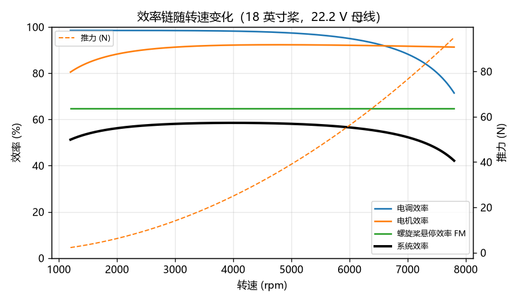
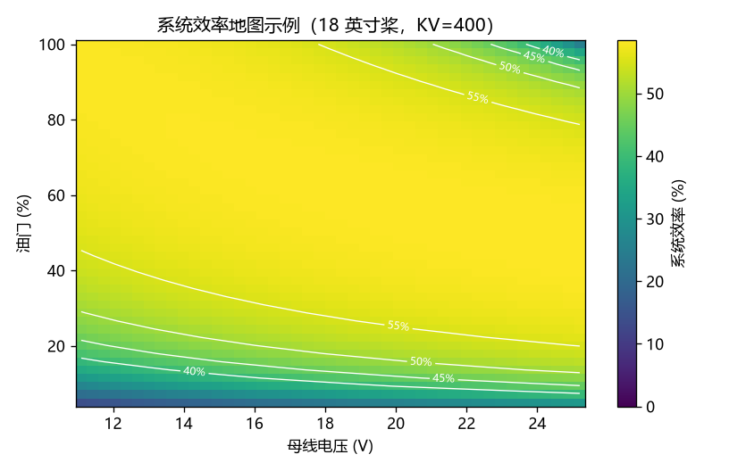
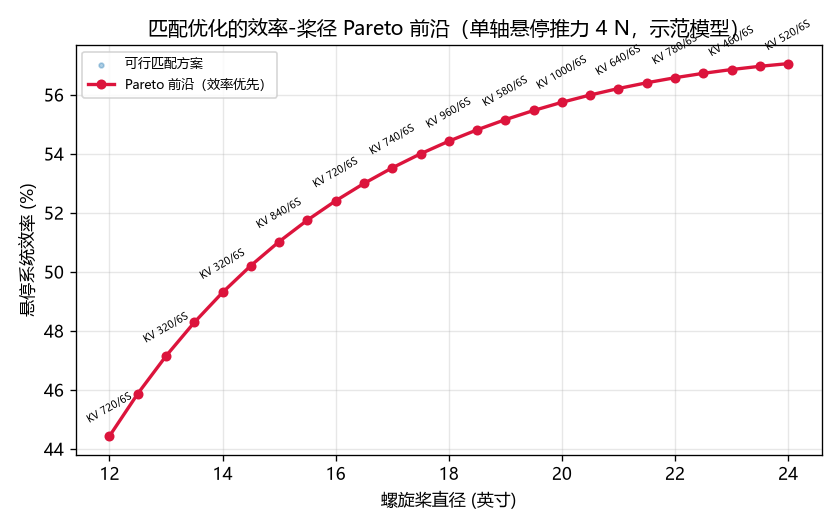
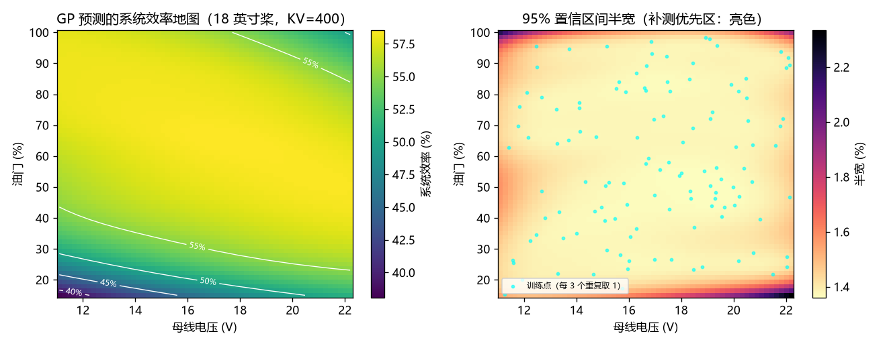
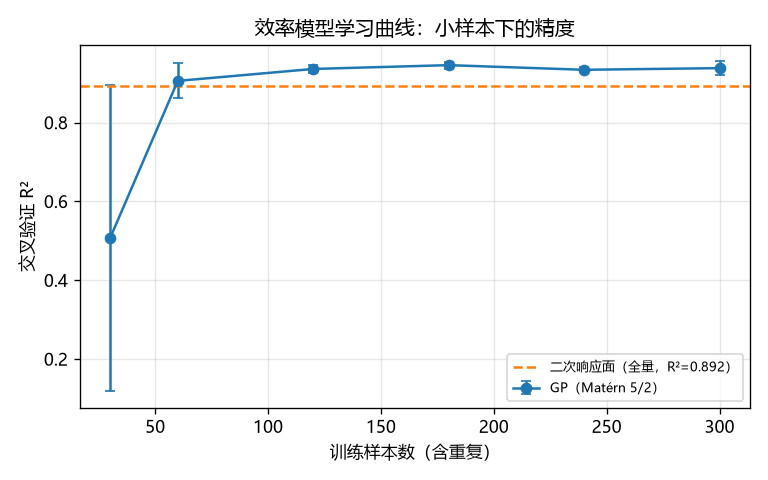

## 八、技术预研（阶段 0 结论）

> 本章是项目启动前完成的技术预研结论，来源为调研报告 `work/research/bench_tech.md`（台架与测量）与 `work/research/modeling_opt.md`（建模与优化），详细推导、选型表与文献见原报告。所有“待核实”数值不得写入申报书定稿，正式报告一律以实测替换。

### 8.1 效率定义与系统边界

- 能量流：`电池 → 母线（DC） → 电调（三相 PWM） → 电机（轴） → 螺旋桨（气动） → 理想诱导功率`。
- 系统效率定义：**η_sys = P_ideal / P_dc**，其中 P_dc = U_dc·I_dc（电调输入端），理想诱导功率按动量理论 P_ideal = T^{3/2} / √(2ρA)，A = πD²/4。
- 各部件效率：电调效率 η_esc = P_ac/P_dc；电机效率 η_mot = P_shaft/P_ac（P_shaft = 2πnQ/60）；螺旋桨悬停效率 FM = P_ideal/P_shaft；系统效率 η_sys = η_esc·η_mot·FM。
- **重要边界（必须写进报告）**：①静态悬停时飞行器不做有用功，前飞效率公式不适用，统一用悬停效率 FM；②本科预算下电调效率单独测不可行（三相 PWM 需 ≥1 MHz 带宽三相功率分析仪），本项目改报“电调+电机”组合效率 η_esc+mot；③台架测的是“电调输入端→理想诱导功率”，不含电池放电效率与线路损耗，建议用可编程直流电源固定母线电压，把“电压”变成独立可控工况。

### 8.2 误差链与精度目标

- 对数微分：u(η_sys)/η_sys = √[(1.5u_T)² + (0.5u_ρ)² + (0.5u_A)² + u_U² + u_I²]。**推力误差放大 1.5 倍，是全链路最敏感量**；转速误差经 T∝n²、P∝n³ 放大。
- 设计目标（k=2）：η_sys 扩展不确定度 ≤2.5%，FM ≤3%，η_esc+mot ≤2%；对标文献某测试系统推力/扭矩/电机效率误差约 1.02%/10%/10.04%，本方案目标更严，能否达到取决于轴承摩擦与线缆扭矩控制。
- 对策：标定资源优先给推力与扭矩（标准砝码、反扭矩臂、正反两向标定）；转速用光电+霍尔冗余；环境温湿度气压记录用于空气密度修正。

### 8.3 台架总体方案（A/B 双方案）

| 项目 | 方案 A：低成本入门型（本项目主方案） | 方案 B：实验室级（中期后升级） |
| --- | --- | --- |
| 投入 | 0.6—1.5 万元 | 8—20 万元（部分复用实验室设备） |
| 机架 | 4040/4080 铝型材单立柱 + 悬臂 + 直线导轨 | 龙门双立柱 + 铸铁基座 + 阻尼隔振 |
| 推力 | S 型拉压力传感器直连 | 高精度传感器 + 二级模拟滤波 |
| 扭矩 | **反扭矩臂 + 可换拉压力传感器**（定子装在深沟球轴承上） | 旋转/反作用式扭矩传感器 |
| 转速 | 光电反射式 | 光电 + 磁编码器互校 |
| 电参量 | 霍尔电流 + 分压 + 24 bit ADC | 三相功率分析仪 + 分流器 |
| 采集 | ESP32/STM32 + 外置 ADC（≥1 kS/s） | NI cDAQ（背板同步） |

- 推荐路径：先按 A 跑通“1 台电机 × 3 支桨”，再用 A 的数据确定 B 的量程与工况范围；A 与 B 同工况偏差 <3% 可作为中期成果。
- 机械设计硬指标：桨盘离地 ≥1.5D（抑制地面效应）；台架一阶固有频率 ≥3 倍桨叶通过频率；电机座满载挠度 <0.1 mm；桨盘下游 1D 内无立柱/线缆；线缆沿力流垂直方向引出并做 tare；桨必须动平衡。

### 8.4 传感器与采集选型（量程分档是核心）

| 量 | 方案 | 量程/规格 | 说明 |
| --- | --- | --- | --- |
| 推力 | S 型拉压力传感器（应变桥） | 0—2 kg 与 0—10 kg 两档，0.05% FS | 分辨率 1 g 级 |
| 扭矩 | 反扭矩臂 + 拉压力传感器 | 力臂 0.2—0.3 m，传感器 0—5 N/0—20 N/0—50 N 三档 → 1—15 N·m | 换传感器即换量程，成本最低 |
| 转速 | 光电反射式（桨毂贴反光片） | 0—50000 r/min，±1 r/min | 每转 1 脉冲，检测距离 5—30 mm |
| 母线电压 | 分压 + 隔离放大器 | 0—60 V，0.1% | 注意共地 |
| 母线电流 | 精密分流器 75 mV/60 A + 隔离放大 | 0—60 A（峰值 100 A） | 分流器需散热；INA226 备选 |
| 温度 | K 型热电偶（电机/电调） | −20—150 °C | 冷端补偿 |
| 环境 | 温湿度气压模块 | ±0.3 °C / ±2%RH / ±1 hPa | 用于空气密度计算 |

- **采样率下限**：力/扭矩 ≥1 kS/s（或 10 Hz 模拟低通 + 1 kS/s）；电压电流 ≥10 kS/s 或功率分析仪积分；转速 ≥1 kS/s。HX711（10/80 SPS）只能做原理验证，不能出正式数据（2 叶桨 6000 r/min 桨叶通过频率已 200 Hz，会混叠）。
- 采集方案：方案 A 用 ESP32/STM32 + ADS1256/ADS1232（24 bit，8 通道，单芯片 µs 级同步）；方案 B 用 NI cDAQ + NI-9237/9215（背板 ns 级同步）。
- 采购优先级：传感器精度 + 标定砝码 + 防护罩 + 可编程直流电源 ＞ 采集卡/扭矩传感器，因为方案 A 架构允许平滑升级。

### 8.5 标定与不确定度

- 推力：M1 级标准砝码 0/20/40/60/80/100% FS，正反两向加载，最小二乘拟合 F=kV+b，标定后 30 min 复测零点评估蠕变。
- 扭矩：力臂 + 砝码，力臂长度用卡尺/刀口实测（0.2 m ±0.2 mm → 0.1%），力臂严格水平，正反两向各做一次。
- 转速：已知频率方波模拟脉冲核对计数；再用频闪仪比对。
- 电压/电流：6½ 位数字多用表与精密分流器比对 5/10/50 A 点，做线性修正。
- 不确定度：按 GUM 方法分 A 类（重复性）与 B 类（标定、分辨力、温漂等），合成后给扩展不确定度；**设计预算示例值必须被实测重复性替换**。

### 8.6 试验设计与工况矩阵（按物理边界裁剪）

- 三个自变量：母线电压（4 水平：11.1/14.8/22.2/29.6 V，3S/4S/6S/8S）、转速/油门（8 水平）、电机-桨组合（6 组：3 支桨 × 2 台电机）。
- 全因子 4×8×6 = 192 工况，每工况 3 次重复 → 576 点，约 5 个工作日。
- **重要裁剪**：桨尖马赫数 Ma_tip = πDn/(60a) ≤ 0.6（a≈340 m/s）——30 in 桨可用转速上限约 5000 r/min，12000 r/min 只对 ≤13 in 桨有意义，工况矩阵必须按此裁剪，否则会出现物理上不可能的试验点。
- 方法节奏：第 1 周用正交表 L18 做因子筛选；第 2—3 周做 6 组全因子；第 4 周补测边界点与重复性；二期扩展时用拉丁超立方（连续变量）与响应面（单组合精细寻优）。
- 每工况稳定 3—5 s 后取 3—5 s 平均，判据为推力与转速滑动标准差 <1%。

### 8.7 安全规范要点（硬性条款）

全包围防护罩（5 mm PC 板/2 mm 铝网，严禁无罩试转）；急停串在电调供电回路（非仅 PWM）并配总断路器；LiPo 防火袋/沙桶存放，充电不离人，鼓包立即隔离；运行时人员位于桨盘平面外 ≥1.5 m，单人不得独自试验；护目镜与束发；拆装前断电、电容放电 ≥30 s。

### 8.8 预研演示与工具链验证

已用简化的机理模型完成一次“效率链—效率地图—匹配优化”的端到端演示（`work/prestudy/efficiency_demo.py`），验证了工具链与数据格式：

- 模型假设（示例值，待实测替换）：推力系数 C_T=0.105、功率系数 C_P=0.042；铜损系数 k_cu=20 W/(N·m)²；铁损 k_fe=0.02；风阻 1.5×10⁻⁵；电调效率 0.985−0.02(I/40)²。
- 输出：图 1 效率链随转速变化（电调/电机/螺旋桨 FM/系统效率 + 推力曲线）；图 2 油门×母线电压的系统效率地图（热图 + 等高线）；图 3 桨径—悬停效率的 Pareto 前沿（25 个网格方案 + NSGA-II 80 个种群方案）。
- 结论：工具链（numpy/pandas/scipy/matplotlib/scikit-learn/pymoo）全部跑通、中文绘图正常；该演示可作为算法骨架，后续替换为实测数据与真实电机/桨参数。

预研图件（示例模型输出，正式版替换为实测数据）：

### 8.9 可引用的标准与数据源

- GB/T 38058—2019《民用多旋翼无人机系统试验方法》：已核实为现行国家标准，2019-10-18 发布、2020-05-01 实施，归口 SAC/TC 435，起草单位含中国航空综合技术研究所、大疆、北京航空航天大学等；标准适用于“民用多旋翼无人机系统及部件试验方法，最大起飞质量 150 kg 以下的民用轻小型电动多旋翼无人机系统及部件（其他类型可参照执行）”。可作为试验大纲的框架依据，但**是否包含动力系统效率/推力测试的专项条款尚未核实**，引用时只写标准名称，不写具体条款号。
- 相关国际标准：ISO 4358:2023《Test methods for civil multi-copter unmanned aircraft system》（2023-05-04 发布，民用多旋翼试验方法），可作为试验设计的国际对照。
- GB 42590—2023《民用无人驾驶航空器系统安全要求》（强制性）：安全底线要求。
- GB/T 38924 系列《民用轻小型无人机系统环境试验方法》：用于后续“环境对效率影响”的扩展试验设计。
- 公开数据：UIUC Propeller Database（低雷诺数桨 C_T/C_P 实测数据，可用于交叉校验）、APC 桨几何文件（BEMT 复算）。
- **诚实结论**：截至检索未发现专门规定“多旋翼动力系统效率测试/效率地图”的国家/行业标准，申报书宜表述为“现有标准侧重安全性与环境适应性，动力系统效率测试方法尚无统一规范（据公开标准信息检索）”。

### 8.10 仍需确认的问题（进入实施前解决）

1. GB/T 38058—2019 已核实适用范围与发布实施信息，但尚未获取全文条款清单——需查原文确认是否含动力系统效率/推力测试条款（在此之前引用只写“试验方法标准”）；
2. 典型系数范围与 FM 区间均为工程经验值，只用于量级校核；
3. 西安当地重力加速度需用计量部门公布值或实测；
4. UIUC 数据库中与 5—30 in 桨对应的具体型号需逐一比对；
5. 传感器、采集卡、电源的具体型号与价格需按学校采购渠道询价后确定。

### 8.11 GP 代理模型预研（示范算例：学习曲线与不确定度）

- 目的：验证“效率地图 = 数据驱动模型”的完整流程——模拟台架采样 → GP 拟合 → 交叉验证 → 地图与不确定度 → 补测点推荐，并定量回答“每个组合需要多少测点”。
- 设置：18 in 桨、KV=400 的示范模型（`work/prestudy/prestudy_gp.py`），输入为归一化母线电压与油门，输出系统效率；120 个工况 × 3 次重复 = 360 条样本，模拟台架相对噪声 1.2%（约 0.7 个百分点）；核函数为 Matérn 5/2 + WhiteKernel，5 折交叉验证。
- 结果：GP 交叉验证 R²=0.949、RMSE=0.70 个百分点，已接近噪声水平（说明在该示范任务上 GP 达到数据精度上限）；同一数据下二次响应面（RSM）R²=0.892、RMSE=1.02 个百分点，GP 明显更优。
- 学习曲线：30 样本 R²≈0.51（不稳定）→ 60 样本 0.906 → 120 样本 0.936 → 180 样本 0.946 → 240 样本 0.934 → 300 样本 0.938；**约 120—180 条样本（40—60 个工况 × 3 重复）后进入平台期**，与调研“每组合 100—200 点”的建议一致，可作为正式试验规模的依据。
- 不确定度：95% 置信区间半宽在实测覆盖区约 1.4—2.3 个百分点，边界（尤其低油门端）明显更大；按“最大不确定度”自动推荐的下一个补测点全部集中在低油门边界，验证了“序贯补点 + 边界加密”的必要性。
- 结论与使用边界：①正式研究用实测数据重跑同一套流程（脚本、特征与数据格式已固定，只需替换数据源）；②示范模型较平滑，真实数据可能含更多局部结构，届时需增加机理约束（灰箱模型）与边界测点；③模型精度目标定为“预测误差 ≤1 个百分点或 ≤ 测量扩展不确定度（先达到者为准）”，避免无效增加测点。

---

## 九、风险识别与应对

| 风险 | 可能性 | 影响 | 应对措施 |
| --- | --- | --- | --- |
| 台架标定不达标（推力/扭矩误差大） | 中 | 高 | 优先保证传感器精度与标定砝码；正反两向标定；请研究生/实验员指导；预留 2 周返工缓冲 |
| 采购周期长（传感器、导轨、电源） | 高 | 中 | 2026 年 12 月前下单；先用手边材料搭临时台架验证方案；关键件准备国产替代型号 |
| 零部件加工/装配延误 | 中 | 中 | 优先 3D 打印与标准件；工程训练中心加工需提前预约 |
| 课程考试与假期导致投入不足 | 高 | 中 | 学期内每周固定 2 个半天；寒暑假集中推进关键节点；任务拆到 2 天粒度 |
| 数据质量差（重复性差、混叠、漂移） | 中 | 高 | 严格执行采样率下限；每工况 3 次重复与波动判据；当天备份与质量检查 |
| 专业基础不足（大一新生） | 高 | 中 | 按技能清单补基础；研究生传帮带；先做“能跑通”的简化版本再迭代 |
| 模型精度不达标（R²<0.90） | 中 | 中 | 机理解析 + 数据驱动混合建模；增加试验点；交叉验证；必要时缩小适用范围并说明 |
| 优化结果无法台架复现 | 中 | 高 | 优化结果必须回台架复测；模型修正闭环；保留 Pareto 方案而非单一方案 |
| 安全事件（桨叶飞出、电池起火） | 低 | 极高 | 全包围防护罩、急停、防火袋、双人在场；安全培训与检查表签字，严格执行 |
| 论文/软著成果不足 | 中 | 低 | 结题以研究报告 + 数据/代码为主，论文“力争”；提前了解软著申请流程 |

---

## 十一、近期启动清单（2026-11-17 至 2026-11-30）

### 11.1 第一周（11-17 至 11-23）

- [ ] 召开项目启动会：明确分工、周会时间、周报模板、Git 仓库（负责人 A，全体）
- [ ] 建立目录结构与共享网盘，创建 README（负责人 A）
- [ ] 每人注册/登录知网、IEEE Xplore，完成 5 篇文献检索（全员，对应技能 R1）
- [ ] 通读《推进规划》与《项目技能清单》，认领技能学习任务（全员）
- [ ] 向指导教师汇报规划并确认：测试对象（电机/桨/电调型号）、可用实验室设备与场地（负责人 A）
- [ ] 请课题组研究生讲解实验室安全规范与设备使用（负责人 A 组织）
- [ ] 学习 Python 基础并跑通 `work/prestudy/efficiency_demo.py`，看懂 3 张预研图（全员，技能 S1）
- [ ] 跑通 `work/prestudy/prestudy_gp.py`，读懂学习曲线与不确定度图，理解“每组合测多少点”的依据（负责人 E，技能 O2/O3）

### 11.2 第二周（11-24 至 11-30）

- [ ] 完成台架方案初稿：机械结构草图 + 测点布置 + 传感器选型表（负责人 B、C，技能 M1/E2）
- [ ] 完成采购 BOM 初稿并询价（负责人 A、C）
- [ ] 搭建“最小可行采集链路”：ESP32/STM32 + 传感器 → 串口 → CSV（负责人 C，技能 E3）
- [ ] 用标准砝码做一次推力/扭矩标定预演（负责人 B、C，技能 M4/E2）
- [ ] 完成 20 篇文献库 + 10 张精读卡片（全员，技能 R1/R2）
- [ ] 写出第一份《效率指标体系与测试条件说明》初稿（负责人 A、E）
- [ ] 第一次周会复盘：检查技能自评表、任务看板、下周计划（全员）

### 11.3 需在 11 月底前确定的关键输入

1. 被测电机/桨/电调的型号与数量（向指导教师确认，或由实验室提供）；
2. 台架安放位置与可用电源（220 V 插座、功率限制、接地）；
3. 传感器与采集卡采购渠道与预算分配（对齐申报书经费预算：仪器设备购置费 4000 元、材料费 1500 元、实验装置试制费 1500 元）；
4. 实验室安全准入流程与设备培训安排。

---

## 附录 A 传感器与采集选型清单（精简版）

| 类别 | 规格要求 | 数量 | 估算 | 用途 |
| --- | --- | --- | --- | --- |
| 推力传感器 | S 型拉压力，0—2 kg / 0—10 kg，0.05% FS | 各 1 | 几百元级 | 推力测量（分档） |
| 扭矩传感器 | 拉压力 0—5 N / 0—20 N / 0—50 N（反扭矩臂用） | 各 1 | 几百元级/支 | 扭矩分档测量 |
| 桥式采集 | ADS1256/ADS1232 模块（24 bit，8 通道） | 1 套 | 几百元级 | 力/扭矩采集 |
| 转速传感器 | 光电反射式 + 反光片 | 1 | 几十元级 | 转速 |
| 电流测量 | 精密分流器 75 mV/60 A + 隔离放大 | 1 套 | 几百元级 | 母线电流 |
| 电压测量 | 分压 + 隔离模块（0—60 V） | 1 | 几十—几百元级 | 母线电压 |
| 温度 | K 型热电偶 + MAX31855 | 2—3 | 几十元级 | 电机/电调温度 |
| 环境 | 温湿度气压模块 | 1 | 几十元级 | 空气密度修正 |
| 机械 | 铝型材 + 直线导轨 + 轴承座 | 1 套 | 千元级 | 台架本体 |
| 安全 | 全包围防护罩 + 急停 + 断路器 | 1 套 | 几百—千元级 | 安全（不可省） |
| 标定 | M1 级标准砝码 0.1—5 kg | 1 套 | 几百—千元级 | 推力/扭矩标定 |
| 电源 | 可编程直流电源 0—60 V/0—60 A | 1 | 千元—万元级 | 固定母线电压 |

## 附录 B 测试记录表字段模板（可直接建表）

| 字段 | 符号/单位 | 来源 | 说明 |
| --- | --- | --- | --- |
| 记录 ID | run_id | 自动 | 日期-组合-电压-转速-重复 |
| 日期时间 | ts (ISO8601) | 系统 | 精确到秒 |
| 操作人 | operator | 手填 | 双人签字 |
| 试验阶段 | phase | 手填 | 筛选/全因子/复测 |
| 电机/电调/螺旋桨 | motor/esc/prop | 手填 | 含 KV、桨径×螺距×叶数 |
| 桨动平衡 | balanced | 手填 | Y/N |
| 环境条件 | T_amb/RH/p/ρ | 传感器+计算 | 空气密度修正 |
| 电压/电流 | U_dc (V)/I_dc (A) | 采集 | 稳态窗口均值 |
| 输入功率 | P_dc (W) | 计算 | U_dc·I_dc |
| 转速 | n (r/min)、n_std | 采集 | 窗口均值与标准差 |
| 推力 | T (N)、T_std | 采集 | 窗口均值与标准差 |
| 反扭矩 | Q (N·m)、Q_std | 采集 | 窗口均值与标准差 |
| 温度 | T_motor/T_esc (°C) | 传感器 | 试验前后各一次 |
| 派生量 | P_shaft、P_ideal、C_T、C_Q、FM、η_esc+mot、η_sys、g/W | 计算 | 公式见第八章 |
| 稳态窗口 | t_win (s) | 采集 | 用于溯源 |
| 备注 | note | 手填 | 异常、异响、电压跌落等 |

## 附录 C 参考资料与数据源

1. 调研报告全文：`work/research/bench_tech.md`（台架、传感器、标定、试验设计、标准与文献）、`work/research/modeling_opt.md`（效率建模与匹配优化）。
2. 申报书与文献综述：`work/research/research_brief.md`（17 条 GB/T 7714 文献，含 DOI）。
3. GB/T 38058—2019、GB 42590—2023、GB/T 38924 系列（国家标准全文公开系统）。
4. UIUC Propeller Database（https://m-selig.ae.illinois.edu/props/propDB.html）、APC 桨几何文件（https://www.apcprop.com/technical-information/file-downloads/）。
5. 预研演示代码与图件：`work/prestudy/`（`efficiency_demo.py`、`prestudy_gp.py`、fig1—fig5、CSV、`gp_metrics.json`）。

## 附录 D 环境与文件清单

| 文件/目录 | 说明 |
| --- | --- |
| `work/plan/plan_full.md` | 本规划文档的 Markdown 源文件 |
| `work/plan/md2docx.py` | Markdown → 中文 Word 转换脚本 |
| `work/plan/skills.md` | 技能清单源文件（对应第十章） |
| `work/env/requirements.txt` | Python 依赖清单 |
| `work/env/check_env.py` | 环境自检脚本 |
| `work/prestudy/efficiency_demo.py` | 效率链/效率地图/Pareto 预研演示 |
| `work/prestudy/prestudy_gp.py` | GP 代理模型、学习曲线与不确定度预研 |
| `work/prestudy/fig/` | 预研图件（图 1—图 5） |
| `work/research/` | 调研报告（台架、建模、文献综述） |
| `work/pylibs/` | 项目本地 Python 库（matplotlib、scipy、scikit-learn、pymoo 等） |
| `软件环境与使用说明.md` | 环境安装、复现与常见问题说明 |
